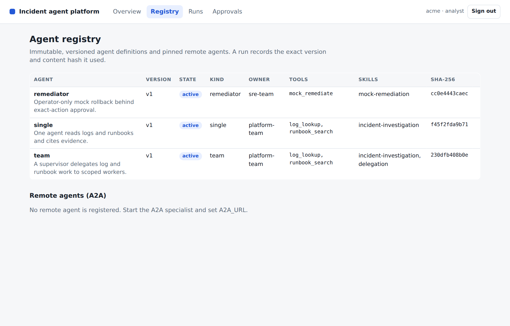
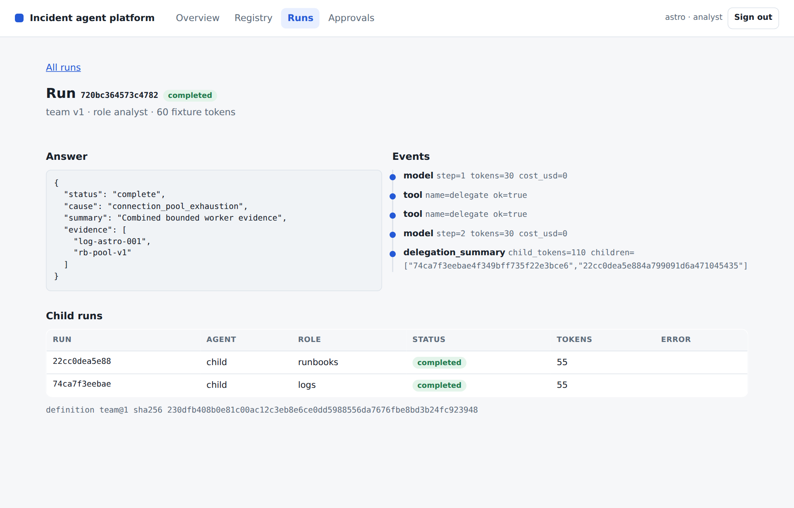
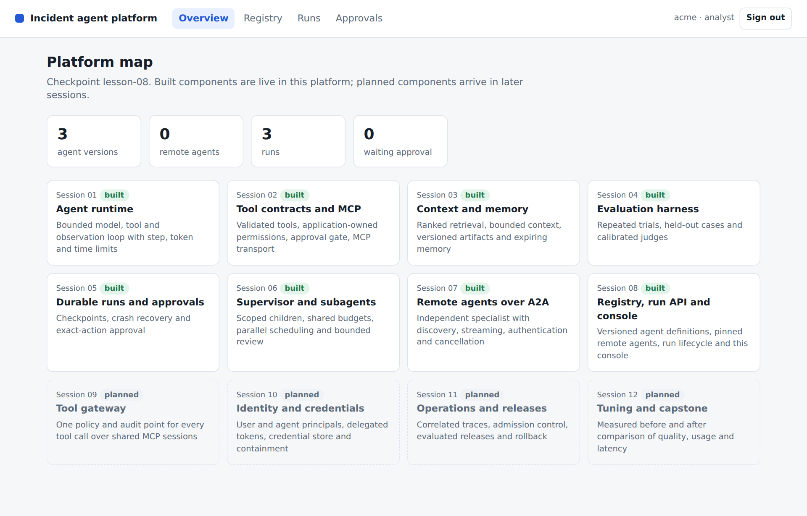
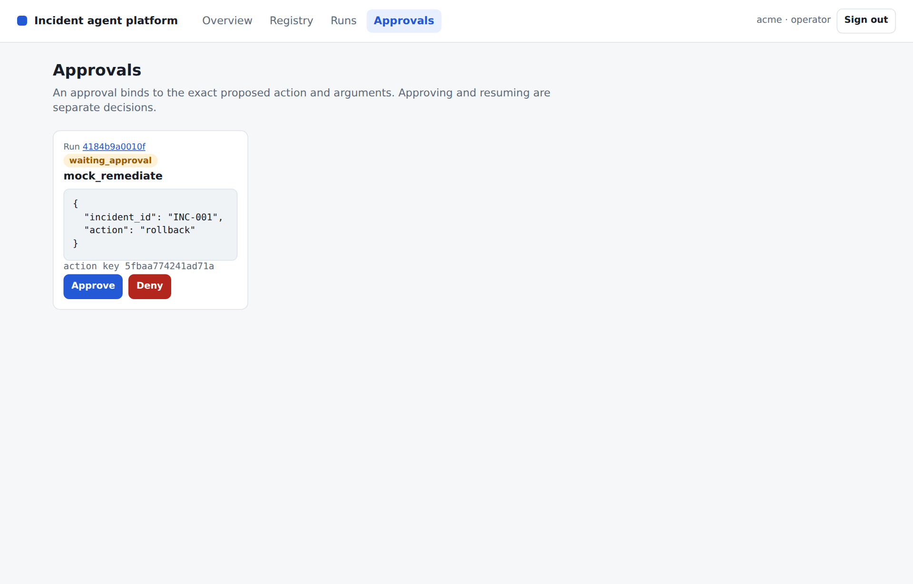

# Lesson 08 Platform core, agent registry and console

*Instructor guide for the L3 agentic platform programme*

**Outcome** Agents become validated, immutable registry definitions that run through one platform API, remote A2A agents are pinned by Agent Card hash, and analysts and operators inspect the platform in a tenant-scoped console.

Duration: 90 minutes. Starting checkpoint: lesson-07. Ending checkpoint: lesson-08 (21a8a6e).

Word version: [08 Platform core agent registry and console.docx](08%20Platform%20core%20agent%20registry%20and%20console.docx)

## Where this session sits in the platform

This session turns the separate capabilities from Sessions 01 to 07 into a platform: an agent registry, a run API and the platform console. From here every agent is a registered, versioned definition, and every run records the exact version and content hash it used. The console appears for the first time with Overview, Registry, Runs and Approvals views; Sessions 09, 10 and 11 add Gateway, Identity and Operations views to the same console.

| Session | Platform component | Status |
|---|---|---|
| 01 | Agent runtime: bounded ReAct loop, typed run state, event log | Built earlier |
| 02 | Tool contracts, approval boundary and MCP transport | Built earlier |
| 03 | Context selection, retrieval, memory and versioned artifacts | Built earlier |
| 04 | Evaluation harness and single-agent baseline | Built earlier |
| 05 | Durable runs, crash recovery and exact-action approval | Built earlier |
| 06 | Supervisor, scoped subagents and parallel coordination | Built earlier |
| 07 | Remote agents over A2A | Built earlier |
| 08 | Platform core: agent registry, run API and platform console | **This session** |
| 09 | MCP tool gateway: policy, audit and shared upstream sessions | Later session |
| 10 | Agent identity, delegated credentials and credential store | Later session |
| 11 | Operations: traces, admission control and evaluated releases | Later session |
| 12 | Tuning, before/after evidence and the capstone presentation | Later session |

## Preparation

Bring your Session 07 checkpoint, including the A2A runbook specialist. Read the A2A agent discovery guidance and the OWASP cross-site scripting prevention cheat sheet. Learners need a desktop browser on the machine where their coding agent runs.

Before class, have your coding agent start the completed lesson-08 API on loopback and confirm that all three demo identities can sign into the console.

Learners need two things: their own project repository in the course GitLab group, and the [learner kit](https://github.com/maxvpavlov/ciklum-innovate-l3-2026/tree/main/learner-kit) in the public course repository, which holds the starter project and, for each lesson, the given files and the check pack. Learners build their own implementation; the reference checkpoints in the same repository are the instructor's answer key.

Your coding agent handles preparation, implementation and execution. You set the scope, inspect its changes and explain the evidence. This development assistant is separate from the investigation agents inside the platform.

> **PROMPT** Prepare my learner project for Lesson 08. Open my project repository in my course GitLab group, cloning it into ~/agentic-course/my-platform if it is not there, and confirm it holds my completed lesson-07 work with all its checks passing. Update my read-only copy of the course repository in ~/agentic-course/course, cloning it from https://github.com/maxvpavlov/ciklum-innovate-l3-2026 if it is missing; its learner-kit folder is the course kit. Use the pinned Python 3.12 environment and the offline mock provider. Do not add this lesson's work yet. Report the project location, its current checkpoint, the test results and any missing prerequisites. Do not ask me to run terminal commands.

Next, have the coding agent read this lesson's check pack and add it to the project before any code is written.

> **PROMPT** Read learner-kit/lessons/08 in the course repository: its README, the given files and the check pack. Copy the whole given files and the check pack into my project exactly as the README says, without changing them, and commit that; a given definition that must be pasted into a module is added in the build step that creates or changes that module. Then run the tests and report what fails and why: at first this lesson's test file may fail to import, because the modules it needs do not exist yet. List the interfaces my code must provide, with the exact names, signatures, fields and error codes the tests use, and the capability they verify. Explain the implementation sequence before we begin. Do not write the implementation yet, and do not look for or use a finished solution.

**Instructor readiness** Rehearse the session with a learner project built from the course kit, so you see what learners see: the check pack fails until each capability is built. The reference checkpoint remains your answer key for the excerpts below. In class, use one bounded prompt at a time; learners inspect the change, explain the control decision and review the check evidence.

**Offline fallback** Have the coding agent use the offline mock provider for class. If live access fails, restore that configuration and continue. Keep credentials in secure configuration. Adapter request shapes were tested with mock HTTP; live account access was not exercised.

Pinned versions in pyproject.toml and uv.lock: Python 3.12, MCP 2.2.0, A2A SDK 1.1.2, httpx 0.28.1, FastAPI 0.141.1, uvicorn 0.52.4, jsonschema 4.26.0, pytest 9.1.1 and pytest-asyncio 1.4.0. Have the coding agent manage their installation.

## Timed agenda

| Minutes | Activity | Format |
|---|---|---|
| 00 to 10 | Reconnect to the incident and prior checkpoint | Discussion |
| 10 to 30 | Concept script and architecture questions | Discussion |
| 30 to 45 | Prompts and code review for steps 1 and 2 | Agent build |
| 45 to 60 | Prompts and code review for steps 3 and 4 | Agent build |
| 60 to 75 | Learner exercise and fault injection | Practice |
| 75 to 85 | Acceptance checks and result interpretation | Verification |
| 85 to 90 | Questions and checkpoint handoff | Discussion |

## Instructor script and code walkthrough

Use SAY for instructor narration, SHOW and REVIEW for the code and evidence participants examine, PROMPT for text they give their coding agents, and PAUSE for discussion. Prompts define scope and expected behaviour; the agent handles command execution. Code excerpts remain as reading and review material from the exact reference checkpoint, not manual typing instructions.

### Opening and orientation

**SAY** Until now each capability has had its own lab entry point. Today the incident assistant stops being the application and becomes one registered agent on a platform. An agent registry holds validated, immutable, versioned definitions. A run API resolves a definition, records exactly which version ran and controls the run lifecycle. A console, served by the platform itself, lets analysts and operators see what exists and what happened. Single-agent and team investigations run through the same API, and the Session 07 specialist becomes a registered remote agent with a pinned card. Open with one question: when an incident answer looks wrong next week, what must you know about the agent that produced it?

**SHOW** The coding agent’s baseline report, current learner project, synthetic incident records and lesson outcome. Ask participants to explain what already works before authorizing the next bounded change.

### Concept discussion

**SAY** Draw three boxes. The registry is the platform's catalogue: which agents exist, who owns them, which tools and skills they declare, and which version is active or retired. The run service takes an authenticated request, resolves a definition, snapshots it into the run and hands the work to a worker that holds a lease. The console is a client of the same API with no privileged back door, so it sees exactly what the signed-in identity may see. Keep two scopes apart: the registry is platform-wide, while runs, approvals and evidence are tenant-scoped. Then name the trust boundaries: definitions are reviewed input, model answers and tool evidence are untrusted text, and a remote agent is trusted only as far as the card we pinned. Be explicit about one teaching compromise. Our workers run each agent inside the platform's own process, next to the API, the database connection and the credential store. In production the control plane and agent execution are separate: agents run in their own worker processes or sandboxed containers, often one per run, so a misbehaving or compromised agent cannot reach the platform's memory, data or secrets, and the runtime is a library those workers share. We keep them together so the whole platform runs on a laptop with one command; the A2A specialist from Session 07 already shows the out-of-process shape, with its own identity and its own token.

**PAUSE** Invite one learner to trace the control flow and another to identify a failure boundary. Resolve different interpretations before opening the implementation.

### 1 Register validated, immutable agent versions

**SAY** Open the registry. A definition is validated against AGENT_SCHEMA before anything is stored: kind, description, owner, allowed tools, skills, prompt and context budget, with no additional properties. So a definition that smuggles in an api_key field fails as invalid_definition, and an allowed tool the platform does not know, such as shell_exec, fails as unknown_tool. The content hash is the SHA-256 of the canonical JSON. Registering identical content again is harmless; different content under an existing version fails as immutable_definition. Lifecycle is kept apart from content: one version per name is active, any non-retired version can be activated, and the active version cannot be retired. Ask learners what a retired version still means for runs that already used it.

**SHOW** The current learner implementation and `incident/registry.py`. Use the following prompt to make the bounded change, then inspect the agent’s result.

> **PROMPT** For Lesson 08, continue in my learner project. Add an agent registry in incident/registry.py on the platform's SQLite file. Validate each definition against a strict schema, require known tools, store a SHA-256 content hash and reject different content under an existing version. Track one active version per agent, allow activating any non-retired version and refuse to retire the active one. Seed single, team and remediator at version 1. Show the rejection codes for an unknown field, an unknown tool and an in-place rewrite. Build to the interfaces the Lesson 08 check pack uses, and do not edit the check pack or the given files. Preserve earlier behaviour, run relevant checks and show the change and observed evidence. Stop at this step.

**REVIEW** Compare the coding agent’s change with this reference excerpt. It covers source lines 38 to 54 at lesson-08; common indentation is reduced for display. Ask the agent to explain material differences in behaviour.

```python
def register(self, name, version, spec):
    if not re.fullmatch(r"[a-z][a-z0-9-]{1,40}", name) or not isinstance(version, int) or version < 1:
        raise ValueError("invalid_agent_identity")
    try:
        validate(spec, AGENT_SCHEMA)
    except ValidationError:
        raise ValueError("invalid_definition") from None
    if self.known_tools and not set(spec["allowed"]) <= self.known_tools:
        raise ValueError("unknown_tool")
    body, sha = json.dumps(spec, sort_keys=True), digest(spec)
    old = self.db.execute("SELECT sha256 FROM agents WHERE name=? AND version=?", (name, version)).fetchone()
    if old and old[0] != sha:
        raise ValueError("immutable_definition")
    self.db.execute("INSERT OR IGNORE INTO agents VALUES (?,?,?,?,?,?)",
                    (name, version, body, sha, "available", time.time()))
    self.db.execute("INSERT OR IGNORE INTO active_versions VALUES (?,?)", (name, version))
    return self.get(name, version)
```

**Explain the choice** Validation and immutability happen at registration, before any run exists, so a malformed or rewritten definition never reaches a worker. Keeping lifecycle state outside the hashed content lets operators activate and retire versions without changing what a version means.

**ASK** Why is the lifecycle state not part of the content hash?

**Likely answer** Activating or retiring is an operational decision about the same content. If state were hashed, retiring version 1 would change its identity and break the link between old runs and the definition they actually used.

**PAUSE** Have learners identify the boundary in their agent’s change and explain the expected failure behaviour. Compare it with the reference excerpt before accepting the change.



**CONSOLE** Registry view as the Astro analyst. Point at the version, state and SHA-256 columns, and at the empty Remote agents section: nothing is pinned until a specialist URL is configured.

### 2 Pin remote agents and discover by skill

**SAY** In Session 07 the team discovered the runbook specialist at request time and trusted whatever card came back. Now the platform registers the remote agent once: fetch_card reads the public card, and register_remote stores the URL, the card and its SHA-256. A later registration with a different card fails as agent_card_changed unless someone explicitly accepts the change after review. At run time discover_client fetches the card again and compares its digest with the pin before creating a client, so a card swapped after registration stops the run instead of silently redirecting work. Discovery by skill returns active local agents and pinned remote agents together. Be honest about the limit: the first registration is trust on first use, with no human review.

**SHOW** The current learner implementation and `incident/a2a_client.py`. Use the following prompt to make the bounded change, then inspect the agent’s result.

> **PROMPT** For Lesson 08, continue in my learner project. Register remote A2A agents by pinning the SHA-256 of their Agent Card, and refuse a changed card unless an explicit reviewed acceptance is given. Add discovery by skill across active local agents and pinned remote agents. Make the A2A client check the fetched card against the pin before creating a client, and register the specialist at startup when a remote URL is configured. Demonstrate discovery for the runbooks skill and the refusal of a modified card. Build to the interfaces the Lesson 08 check pack uses, and do not edit the check pack or the given files. Preserve earlier behaviour, run relevant checks and show the change and observed evidence. Stop at this step.

**REVIEW** Compare the coding agent’s change with this reference excerpt. It covers source lines 14 to 28 at lesson-08; common indentation is reduced for display. Ask the agent to explain material differences in behaviour.

```python
async def fetch_card(url):
    """Read the public Agent Card so the platform registry can pin it."""
    async with httpx.AsyncClient(timeout=10) as http:
        return card_dict(await A2ACardResolver(http, base_url=url).get_agent_card())


async def discover_client(http, url, streaming=True, polling=False, pinned=None):
    card = await A2ACardResolver(http, base_url=url).get_agent_card()
    if pinned:
        from incident.registry import digest
        if digest(card_dict(card)) != pinned:
            raise ValueError("agent_card_changed")
    if not any(skill.id == "runbooks" for skill in card.skills):
        raise ValueError("unsupported_capability")
    return ClientFactory(ClientConfig(httpx_client=http, streaming=streaming, polling=polling)).create(card)
```

**Explain the choice** Pinning turns a mutable discovery document into a reviewed dependency. Checking the pin again at call time closes the gap between registration and use, which is exactly where a card substitution would otherwise go unnoticed.

**ASK** Why check the pin at run time if registration already rejects a changed card?

**Likely answer** Registration only sees the card as it was on that day. The remote service can change its card later; the runtime comparison is what stops a run from following the changed card.

**PAUSE** Have learners identify the boundary in their agent’s change and explain the expected failure behaviour. Compare it with the reference excerpt before accepting the change.

### 3 Resolve definitions in the platform core and run API

**SAY** Follow one submission. The API maps the bearer credential to a tenant and a role; the body carries only the incident ID, the agent name and an optional version. submit resolves the definition from the registry, refuses a retired version and requires an operator for the remediator kind. Application code builds Context from the definition's allowed tools, so the model never chooses its own permissions. The resolved definition, with version and hash, is saved on the queued run before work starts. launch then claims a durable lease, and a second claim fails as run_already_owned. The lifecycle endpoints keep the same boundaries: inspect loads only within the caller's tenant, decisions need an operator and the current action key, and resume goes back through the lease.

**SHOW** The current learner implementation and `incident/platform.py`. Use the following prompt to make the bounded change, then inspect the agent’s result.

> **PROMPT** For Lesson 08, continue in my learner project. Build the platform core in incident/platform.py and the run API in incident/api.py. Submission resolves the requested or active definition, refuses retired versions, requires an operator for the remediator, builds the context in application code and saves the queued run with the resolved definition before launch. Claim a durable lease per run. Expose submit, list, inspect, cancel, decision and resume bound to the authenticated tenant, with 404 for another tenant's run and a conflict for a stale action key. Keep every handler asynchronous, because workers and handlers share one SQLite connection. Show both configurations completing with their recorded version and hash. Build to the interfaces the Lesson 08 check pack uses, and do not edit the check pack or the given files. Preserve earlier behaviour, run relevant checks and show the change and observed evidence. Stop at this step.

**REVIEW** Compare the coding agent’s change with this reference excerpt. It covers source lines 81 to 99 at lesson-08; common indentation is reduced for display. Ask the agent to explain material differences in behaviour.

```python
def submit(self, tenant, role, incident_id, agent="single", version=None):
    config = self.registry.get(agent, version)
    if config["state"] == "retired":
        raise ValueError("retired_version")
    if config["spec"]["kind"] == "remediator" and role != "operator":
        raise PermissionError("operator_required")
    context = Context(tenant=tenant, role=role, allowed=tuple(config["spec"]["allowed"]))
    run = Run(context, [{"role": "system", "content": config["spec"]["prompt"]},
                       {"role": "user", "content": f"Investigate {incident_id} payments latency"}],
              status="queued", configuration=config)
    self.store.save(run)
    self.launch(tenant, context.run_id)
    return context.run_id

def launch(self, tenant, run_id):
    self.store.claim(tenant, run_id, self.owner)
    key = (tenant, run_id)
    self.tasks[key] = asyncio.create_task(self._execute(tenant, run_id))
    return self.tasks[key]
```

**Explain the choice** Recording the resolved definition keeps each result reproducible after the registry moves on. The lease decides who executes a run; it complements the Session 05 effect ledger rather than replacing it. Handlers are async because a synchronous handler would run in a thread pool and race the workers on the shared SQLite connection; a test enforces this.

**ASK** Why does inspecting another tenant's run return 404 rather than 403?

**Likely answer** A 403 would confirm that the run exists. Loading only within the caller's tenant means another tenant's run is simply not found, so the API reveals nothing about it.

**PAUSE** Have learners identify the boundary in their agent’s change and explain the expected failure behaviour. Compare it with the reference excerpt before accepting the change.



**CONSOLE** Run detail for a completed team run. Point at the recorded definition team@1 with its hash, the two child runs and the event timeline; token counts are fixture teaching metrics.

### 4 Serve the platform console

**SAY** The console is static files served by the platform at /console: an HTML shell, one stylesheet and ES modules, with no build step and no external scripts. A middleware adds a strict Content-Security-Policy: scripts, styles and connections from the same origin only, no inline script and no framing. Now look at h(). Every API value, including model answers, tool evidence and event details, becomes a text node or an attribute value; nothing is assigned to innerHTML, and a test searches every console script for HTML injection sinks, eval and external URLs. Views call the same API with the signed-in credential, so runs are tenant-scoped, and Activate, Approve and Deny appear only for an operator while the server enforces the same rule.

**SHOW** The current learner implementation and `incident/console/app.js`. Use the following prompt to make the bounded change, then inspect the agent’s result.

> **PROMPT** For Lesson 08, continue in my learner project. Serve a platform console at /console as a static HTML shell with vanilla ES modules, under a strict same-origin Content-Security-Policy with no inline or external scripts. Render every API value as text through a small element helper, never as HTML. Add Overview with the platform map from a blueprint module, Registry, Runs with run detail, and Approvals. Scope views to the signed-in identity and show operator controls only to operators while the API still enforces them. Show me the response headers and the check for HTML injection sinks. Build to the interfaces the Lesson 08 check pack uses, and do not edit the check pack or the given files. Preserve earlier behaviour, run relevant checks and show the change and observed evidence. Stop at this step.

**REVIEW** Compare the coding agent’s change with this reference excerpt. It covers source lines 8 to 21 at lesson-08; common indentation is reduced for display. Ask the agent to explain material differences in behaviour.

```javascript
export function h(tag, attrs = {}, ...children) {
  const node = document.createElement(tag);
  for (const [key, value] of Object.entries(attrs)) {
    if (value === undefined || value === null || value === false) continue;
    if (key.startsWith("on")) node.addEventListener(key.slice(2), value);
    else if (key === "class") node.className = value;
    else node.setAttribute(key, value === true ? "" : String(value));
  }
  for (const child of children.flat()) {
    if (child === undefined || child === null || child === false) continue;
    node.append(child instanceof Node ? child : document.createTextNode(String(child)));
  }
  return node;
}
```

**Explain the choice** Model output and tool evidence are attacker-influenced text. Rendering them as text nodes under a policy that forbids inline script gives two independent layers against injected markup, and a console that uses only the public API cannot see more than its user.

**ASK** If the API already enforces the operator check, why hide the buttons, and why not rely on hiding alone?

**Likely answer** Hiding them is usability: analysts do not see actions they cannot take. It is not a control, because anyone can call the API directly. The server-side operator check is the real boundary.

**PAUSE** Have learners identify the boundary in their agent’s change and explain the expected failure behaviour. Compare it with the reference excerpt before accepting the change.



**CONSOLE** Overview rendered from blueprint.py: Sessions 01 to 08 built, 09 to 12 planned. The counters come from the same tenant-scoped API as every other view.

## Learner practice and checkpoints

> **PROMPT** Help me carry out the Lesson 08 learner exercise in my existing project: Start the platform API on loopback with the offline provider and a temporary database, and give me the console address. I will sign in as demo-astro, submit INC-001 with single and team, and compare the two run details. As demo-locomotive I will confirm that the Astro runs are absent. As demo-operator I will compare the Registry and Approvals views with the analyst's, submit the remediator and decide the pending action myself. Then run a registry version experiment: register single version 2 with a smaller context budget, attempt to rewrite version 1, let me activate version 2 as the operator, submit a run, retire version 1 and try to run it. Confirm that the older run still records version 1 and its hash. First state the expected outcomes, then run the experiment in a throwaway script outside tests/, or from a clean Git state you can restore. Show the observed results and explain any discrepancy. Keep the original acceptance criteria and restore temporary experiments when finished.

**VERIFY** Give the coding agent the verification prompt below, then inspect its evidence and explain the result in your own words.

> **PROMPT** Verify my Lesson 08 implementation against its completion criteria. Update the checkpoint indicator in incident/__init__.py to 8 only when the required capability is present. Run the full test suite, which includes the Lesson 08 check pack and every earlier lesson's tests, and then the Session 08 demonstration with python -m incident.lab 8, all unchanged and using the offline provider. Confirm that the passing count matches the one in the Lesson 08 check pack README. Keep the expected outcomes unchanged. Report checks actually executed, failures, relevant output and any untested integration. Explain the result, then commit my work and push it to my GitLab repository. Do not equate an unrun or skipped check with a pass.

**Expected behaviour** The coding agent returns actual check results and the demonstration’s structured output. Run identifiers and elapsed times vary. Compare the status and capability outcomes with the recorded reference below, and investigate differences.

```json
{
  "registered_agents": [
    "remediator",
    "single",
    "team"
  ],
  "configurations": [
    {
      "agent": "single",
      "status": "completed",
      "definition_version": 1,
      "child_runs": 0
    },
    {
      "agent": "team",
      "status": "completed",
      "definition_version": 1,
      "child_runs": 2
    }
  ],
  "cross_tenant_status": 404,
  "versions_of_single": [
    1,
    2
  ],
  "active_single_version": 1,
  "console": {
    "status": 200,
    "content_security_policy": true,
    "built_components": [
      "runtime",
      "tools",
      "context",
      "evaluation",
      "durability",
      "orchestration",
      "a2a",
      "registry"
    ]
  }
}
```

**PAUSE** Ask learners to explain the evidence before accepting the checkpoint. If a check fails, use the specific recovery prompt below and review the resulting correction.



**CONSOLE** Approvals as demo-operator with a pending mock_remediate proposal. Point at the exact arguments and the action key; an analyst sees only a notice here, and resuming is a separate step.

## Completion criteria

- Definitions are schema-validated, use only known tools and cannot be rewritten under an existing version; the active version cannot be retired and a retired version cannot run.
- Remote agents are pinned by Agent Card hash and discoverable by skill, and a changed card is refused at registration and at call time.
- Single and team configurations complete through the same API, and each run records its definition version and hash.
- A second lease claim is rejected, another tenant's run returns 404, and a decision requires an operator and the current action key.
- The console is served at /console under a strict Content-Security-Policy, renders API data as text only and shows each identity only its tenant's runs; every API handler is asynchronous.

The independently unpacked lesson-08 checkpoint passed its full test suite and this lesson demo, and so does the Lesson 08 check pack from the course kit. Recorded test result: 33 passed in 4.35s. Learners commit and push their checkpoint to their GitLab repository; lesson-08 (21a8a6e) remains the instructor's answer key.

### Files changed in this checkpoint

In the reference, this checkpoint changed the files below. Learners write the implementation files themselves; the lab, the tests and any given files arrive in the Lesson 08 check pack. Ask the agent to explain any additional file changes it needs.

- `incident/__init__.py`
- `incident/a2a_client.py`
- `incident/api.py`
- `incident/blueprint.py`
- `incident/console/app.js`
- `incident/console/console.css`
- `incident/console/index.html`
- `incident/console/views/approvals.js`
- `incident/console/views/index.js`
- `incident/console/views/overview.js`
- `incident/console/views/registry.js`
- `incident/console/views/runs.js`
- `incident/core.py`
- `incident/durable.py`
- `incident/labs/l08.py`
- `incident/platform.py`
- `incident/registry.py`
- `incident/supervisor.py`
- `tests/test_lesson08.py`

> **PROMPT** Review my completed Lesson 08 work against the Lesson 08 check pack and completion criteria. Show the files I changed and the interfaces I provide, and explain how each completion criterion is met with code or test evidence. Point out the design choices I made that the check pack does not force, and what each one costs or gains. Preserve deliberate improvements and earlier capabilities.

## Demo troubleshooting

### The console loads but stays blank

> **PROMPT** I am working on Lesson 08. The symptom is: The console loads but stays blank. Diagnostic focus: Look for Content-Security-Policy violations in the browser developer console: an inline script, a script from another origin, or a page opened as a local file instead of from /console. Recovery guidance: Serve the console from the platform on loopback and keep all scripts as same-origin modules. Do not add unsafe-inline or external sources to the policy. Reproduce the issue, make the smallest necessary correction and rerun affected checks. Report the cause, changed files and observed outcome. Preserve security controls and acceptance criteria.

### Submitting a run returns 400

> **PROMPT** I am working on Lesson 08. The symptom is: Submitting a run returns 400. Diagnostic focus: Read the error code. unknown_agent, unknown_agent_version and retired_version come from the registry lifecycle; the database may hold an earlier experiment. Recovery guidance: List the agent's versions, states and active version. Activate a non-retired version or register a new one; never edit a stored definition in place. Reproduce the issue, make the smallest necessary correction and rerun affected checks. Report the cause, changed files and observed outcome. Preserve security controls and acceptance criteria.

### The team run fails with agent_card_changed

> **PROMPT** I am working on Lesson 08. The symptom is: The team run fails with agent_card_changed. Diagnostic focus: The specialist's current Agent Card no longer matches the pinned hash, often after a restart with a different base URL or card content. Recovery guidance: Compare the pinned and fetched cards and explain the difference. Accept the change explicitly only if it is expected; never remove the runtime pin check. Reproduce the issue, make the smallest necessary correction and rerun affected checks. Report the cause, changed files and observed outcome. Preserve security controls and acceptance criteria.

### Tests fail intermittently after adding an endpoint

> **PROMPT** I am working on Lesson 08. The symptom is: Tests fail intermittently after adding an endpoint. Diagnostic focus: A synchronous handler runs in the framework's thread pool and shares the SQLite connection with running workers; test_api_handlers_run_on_the_event_loop names it. Recovery guidance: Declare the handler asynchronous. Do not delete the test or open an unsynchronised connection per request. Reproduce the issue, make the smallest necessary correction and rerun affected checks. Report the cause, changed files and observed outcome. Preserve security controls and acceptance criteria.

## Practice and discussion

- Draft a second business agent, such as a change-review assistant, as a registry definition: its tools, skills and owner, and which fields the schema would reject.
- Discuss whether the registry should stay platform-wide while runs are tenant-scoped, and who should be allowed to register a definition.

**Discussion prompt** Which decision would change for a larger or more sensitive workload, and what additional evidence would you require before changing it? Tie the answer to the code, the task requirements and the acceptance checks.

## Verification scope

All course tags were independently unpacked and tested. The completed repository has 51 passing tests. Real local MCP stdio, the tool gateway's shared sessions and pinned definitions, A2A HTTP discovery, streaming, delegated-token authentication and cancellation were exercised. The platform console was driven in a headless Chromium browser against every checkpoint from lesson-08 onward.

Live model credentials, paid provider calls, live model judging, third-party MCP or A2A services, remote MCP OAuth, an enterprise identity provider, a managed secret vault, production cloud rollout and an external observability collector were not tested. The offline provider is a deterministic fixture, so its usage and quality results are teaching measurements. Read TESTING.md for the full scope and environment details.

The SQLite mock-effect ledger proves its local transaction boundary. It does not guarantee exactly-once effects for arbitrary external APIs. The A2A specialist task store is in memory. The restricted Compose sandbox uses temporary writable state; persistent deployment storage requires separate configuration and validation.

At lesson-08 the API and console authenticate with fixed demo bearer strings that are for loopback use only; Session 10 replaces them with short-lived signed tokens. Remote Agent Cards are pinned on first registration without review, and every store shares one SQLite file.

Agents run inside the platform process as a teaching compromise. Process or container isolation between the control plane and agent execution was not built or tested.

## Session close

**SAY** The platform now has a catalogue, a front door and a window. Every run names the exact definition that produced it, remote agents are pinned dependencies rather than whatever happened to answer, and the console shows each identity only what the API allows. Keep two teaching shortcuts visible: demo bearer strings that must never leave loopback, and one SQLite file shared by every store. In Session 09 every tool call passes through a gateway, and the console gains a Gateway view.

## References and further study

- [A2A Agent Discovery](https://a2a-protocol.org/latest/topics/agent-discovery/)
- [OWASP Cross Site Scripting Prevention Cheat Sheet](https://cheatsheetseries.owasp.org/cheatsheets/Cross_Site_Scripting_Prevention_Cheat_Sheet.html)
- [MDN Content Security Policy](https://developer.mozilla.org/en-US/docs/Web/HTTP/Guides/CSP)
- [Separating agent execution concerns](https://www.anthropic.com/engineering/managed-agents)
