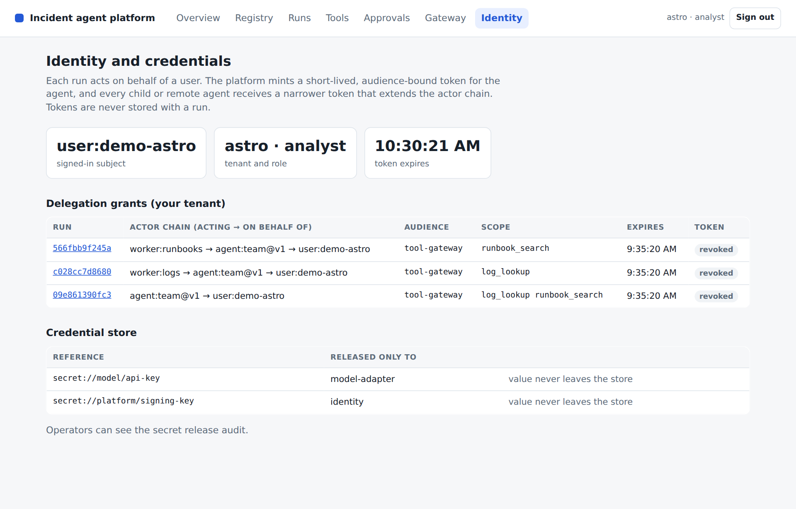

# Lesson 10 Agent identity, delegated credentials and containment

*Instructor guide for the L3 agentic platform programme*

**Outcome** Every run acts for a named user through short-lived, audience-bound tokens that narrow at each child or remote agent. The gateway and the A2A specialist verify them, secrets are released only by reference, and hostile inputs are contained.

Duration: 90 minutes. Starting checkpoint: lesson-09. Ending checkpoint: lesson-10 (c208700).

Word version: [10 Agent identity delegated credentials and containment.docx](10%20Agent%20identity%20delegated%20credentials%20and%20containment.docx)

## Where this session sits in the platform

This session builds the identity component: users and agents become principals, the platform mints signed delegated tokens per run, and a credential store holds upstream secrets that definitions name only by secret:// reference. The Session 09 gateway and the Session 07 specialist become token-verifying boundaries, and the containment checks move into security.py. The console gains an Identity view with the signed-in principal, every delegation grant and its actor chain, and the credential references with their release audit.

| Session | Platform component | Status |
|---|---|---|
| 01 | Agent runtime: bounded ReAct loop, typed run state, event log | Built earlier |
| 02 | Tool contracts, approval boundary, MCP transport and the first console | Built earlier |
| 03 | Context selection, retrieval, memory and versioned artifacts | Built earlier |
| 04 | Evaluation harness and single-agent baseline | Built earlier |
| 05 | Durable runs, crash recovery and exact-action approval | Built earlier |
| 06 | Supervisor, scoped subagents and parallel coordination | Built earlier |
| 07 | Remote agents over A2A | Built earlier |
| 08 | Platform core: agent registry, durable run API, registry and approval views | Built earlier |
| 09 | MCP tool gateway: policy, audit and shared upstream sessions | Built earlier |
| 10 | Agent identity, delegated credentials and credential store | **This session** |
| 11 | Operations: traces, admission control and evaluated releases | Later session |
| 12 | Tuning, before/after evidence and the capstone presentation | Later session |

## Preparation

Bring your Session 09 checkpoint with the gateway audit working. Read the act claim in RFC 8693 and the token-audience rules in the MCP authorization specification. List where your platform asserts a credential or tenant instead of verifying it: demo API credentials, the static A2A token and the model key in the environment.

Learners need two things: their own project repository in the course GitLab group on gitlab.ciklum.net, and the [learner kit](https://github.com/maxvpavlov/ciklum-innovate-l3-2026/tree/main/learner-kit) in the public course repository, which holds the starter project and, for each lesson, the given files and the check pack. Learners build their own implementation; the reference checkpoints in the same repository are the instructor's answer key.

Your coding agent handles preparation, implementation and execution. You set the scope, inspect its changes and explain the evidence. This development assistant is separate from the investigation agents inside the platform.

> **PROMPT** Prepare my learner project for Lesson 10. Open my project repository in my course GitLab group on gitlab.ciklum.net, cloning it into ~/agentic-course/my-platform if it is not there, and confirm it holds my completed lesson-09 work with all its checks passing. Update my read-only copy of the course repository in ~/agentic-course/course, cloning it from https://github.com/maxvpavlov/ciklum-innovate-l3-2026 if it is missing, and tell me the commit it was at before and after the update and which files under learner-kit/lessons/10 changed; its learner-kit folder is the course kit. Use the pinned Python 3.12 environment and the offline mock provider. Do not add this lesson's work yet. Report the project location, its current checkpoint, the test results and any missing prerequisites. Do not ask me to run terminal commands.

Next, have the coding agent read this lesson's check pack and add it to the project before any code is written.

> **PROMPT** Read learner-kit/lessons/10 in the course repository: its README, the given files and the check pack. Copy the whole given files and the check pack into my project exactly as the README says, without changing them, and commit that; a given definition that must be pasted into a module is added in the build step that creates or changes that module. Then run the tests and report what fails and why: at first this lesson's test file may fail to import, because the modules it needs do not exist yet. List the interfaces my code must provide, with the exact names, signatures, fields and error codes the tests use, and the capability they verify. Explain the implementation sequence before we begin. Do not write the implementation yet, and do not look for or use a finished solution.

**Instructor readiness** Rehearse the session with a learner project built from the course kit, so you see what learners see: the check pack fails until each capability is built. The reference checkpoint remains your answer key for the excerpts below. In class, use one bounded prompt at a time; learners inspect the change, explain the control decision and review the check evidence.

**Offline fallback** Have the coding agent use the offline mock provider for class. If live access fails, restore that configuration and continue. Keep credentials in secure configuration. Adapter request shapes were tested with mock HTTP; live account access was not exercised.

Pinned versions in pyproject.toml and uv.lock: Python 3.12, MCP 2.2.0, A2A SDK 1.1.2, httpx 0.28.1, FastAPI 0.141.1, uvicorn 0.52.4, jsonschema 4.26.0, pytest 9.1.1 and pytest-asyncio 1.4.0. Have the coding agent manage their installation.

## Timed agenda

| Minutes | Activity | Format |
|---|---|---|
| 00 to 10 | Reconnect to the incident and prior checkpoint | Discussion |
| 10 to 30 | Concept script and architecture questions | Discussion |
| 30 to 45 | Prompts and code review for steps 1 and 2 | Agent build |
| 45 to 60 | Prompts and code review for steps 3 and 4 | Agent build |
| 60 to 75 | Learner exercise and fault injection | Practice |
| 75 to 85 | Acceptance checks and result interpretation | Verification |
| 85 to 90 | Questions and checkpoint handoff | Discussion |

## Instructor script and code walkthrough

Use SAY for instructor narration, SHOW and REVIEW for the code and evidence participants examine, PROMPT for text they give their coding agents, and PAUSE for discussion. Prompts define scope and expected behaviour; the agent handles command execution. Code excerpts remain as reading and review material from the exact reference checkpoint, not manual typing instructions.

### Opening and orientation

**SAY** Until now the platform trusted a tenant and role that the API attached to a Context. The gateway checked that Context, and the A2A specialist accepted one static shared token and assumed Astro. That does not say who a run acts for, and it gives every remote caller the same power. Today we make identity explicit. A user is a principal, each agent acts on that user's behalf, and every boundary checks a signed, short-lived token instead of trusting the caller. We also keep the containment checks for hostile input: an injected write, path escapes, unapproved egress, fabricated citations and redaction.

**SHOW** The coding agent’s baseline report, current learner project, synthetic incident records and lesson outcome. Ask participants to explain what already works before authorizing the next bounded change.

### Concept discussion

**SAY** Separate authentication, which establishes who is calling, from delegation, which records who acts for whom. RFC 8693 token exchange expresses delegation with a nested act claim: the outermost actor is acting now, and the subject remains the human who started the work. Each token names one audience, so a token minted for the tool gateway is useless at the API or at a remote agent. The MCP authorization specification applies the same rule and forbids passing a client's token through to an upstream service. Delegated tokens expire in minutes and are revoked when the run ends, so they are never saved with run state. Upstream secrets are a separate problem: a credential store names them by reference and releases them only to named consumers, with an audit record.

**PAUSE** Invite one learner to trace the control flow and another to identify a failure boundary. Resolve different interpretations before opening the implementation.

### 1 Principals and signed short-lived tokens

**SAY** Open TokenIssuer. A token has the JWT shape: header, claims and signature, each base64url encoded. issue adds issuer, issue time, expiry and a unique jti. verify checks the signature with a constant-time comparison, then issuer, expiry and the audience the caller expects, and each failure has a distinct reason that later appears in audits and API errors. In the API, /auth/token exchanges a loopback demo credential for a one-hour platform-api token, and the console keeps only that signed token. Name the simplification: one shared HMAC key both signs and verifies, so any verifier could also mint tokens. A production issuer signs asymmetrically and publishes verification keys, for example as JWKS.

**SHOW** The current learner implementation and `agentic_platform/identity.py`. Use the following prompt to make the bounded change, then inspect the agent’s result.

> **PROMPT** For Lesson 10, continue in my learner project. Add a token issuer that signs short-lived JWT-shaped tokens with a configured development key and verifies signature, issuer, expiry and audience with distinct reasons and a constant-time comparison. Let the API exchange a demo credential for a signed platform token and record the signed-in subject on each run. Show tampered, expired and wrong-audience tokens being rejected, and explain why a shared key is a teaching simplification. Build to the interfaces the Lesson 10 check pack uses, and do not edit the check pack or the given files. Preserve earlier behaviour, run relevant checks and show the change and observed evidence. Stop at this step.

**REVIEW** Compare the coding agent’s change with this reference excerpt. It covers source lines 34 to 56 at lesson-10; common indentation is reduced for display. Ask the agent to explain material differences in behaviour.

```python
def issue(self, claims, ttl=300):
    now = int(time.time())
    payload = {**claims, "iss": self.issuer, "iat": now, "exp": now+ttl, "jti": secrets.token_hex(8)}
    signing_input = _encode({"alg": "HS256", "typ": "JWT"})+"."+_encode(payload)
    return signing_input+"."+_encode(hmac.new(self.key, signing_input.encode(), hashlib.sha256).digest())

def verify(self, token, audience):
    try:
        header, payload, signature = token.split(".")
        expected = hmac.new(self.key, (header+"."+payload).encode(), hashlib.sha256).digest()
        valid = hmac.compare_digest(_decode(signature), expected)
        claims = json.loads(_decode(payload))
    except (ValueError, TypeError, AttributeError):
        raise PermissionError("malformed_token") from None
    if not valid:
        raise PermissionError("bad_signature")
    if claims.get("iss") != self.issuer:
        raise PermissionError("wrong_issuer")
    if claims.get("exp", 0) <= time.time():
        raise PermissionError("token_expired")
    if claims.get("aud") != audience:
        raise PermissionError("wrong_audience")
    return claims
```

**Explain the choice** Short expiry limits a leaked token's value, and a mandatory audience stops a token issued for one service being replayed at another.

**ASK** Why compare signatures with hmac.compare_digest rather than ==?

**Likely answer** An ordinary comparison can stop at the first differing byte and leak timing that helps an attacker guess a valid signature.

**PAUSE** Have learners identify the boundary in their agent’s change and explain the expected failure behaviour. Compare it with the reference excerpt before accepting the change.

### 2 Delegate narrower credentials along the actor chain

**SAY** A run never uses the user's API token. When the platform executes a run, Delegation.for_run mints a five-minute tool-gateway token with the user as subject and the agent definition, such as agent:team@v1, as actor. When the supervisor delegates, for_child verifies the parent's token and refuses a wider scope or another tenant with delegation_exceeds_parent. The child keeps the user as subject and nests the parent's actor under a new one; the remote specialist's grant uses its own audience. Tokens live only in memory, while the grants table records jti, chain, audience and scope. In the finally block of Platform._execute, revoke removes the run's tokens and every token delegated beneath it.

**SHOW** The current learner implementation and `agentic_platform/identity.py`. Use the following prompt to make the bounded change, then inspect the agent’s result.

> **PROMPT** For Lesson 10, continue in my learner project. Add delegated credentials. Mint a short-lived tool-gateway token for each executing run, with the user as subject, the agent definition as actor and the run's allowed tools as scope. Give each local or remote child a token that only narrows the parent's scope and extends the actor chain. Record grants for inspection, keep token values out of run state, and revoke a run's tokens and its children's when the run ends. Show the three actor chains of a team run. Build to the interfaces the Lesson 10 check pack uses, and do not edit the check pack or the given files. Preserve earlier behaviour, run relevant checks and show the change and observed evidence. Stop at this step.

**REVIEW** Compare the coding agent’s change with this reference excerpt. It covers source lines 89 to 111 at lesson-10; common indentation is reduced for display. Ask the agent to explain material differences in behaviour.

```python
def for_child(self, parent, child, audience="tool-gateway", actor=None):
    """A child token can only narrow the parent's scope and extends the actor chain."""
    token = self.tokens.get((parent.run_id, "tool-gateway"))
    if token is None:
        raise PermissionError("no_parent_grant")
    claims = self.issuer.verify(token, "tool-gateway")
    requested = set(child.allowed)
    if not requested <= set(claims["scope"].split()) or child.tenant != claims["tenant"]:
        raise PermissionError("delegation_exceeds_parent")
    self.delegated.setdefault(parent.run_id, []).append(child.run_id)
    return self._mint(child.run_id, {"sub": claims["sub"], "tenant": claims["tenant"], "role": child.role,
        "aud": audience, "scope": " ".join(sorted(requested)),
        "act": {"sub": actor or f"worker:{child.role}", "act": claims["act"]}})

def token(self, run_id, audience="tool-gateway"):
    return self.tokens.get((run_id, audience))

def revoke(self, run_id):
    """Revoking a run also revokes every grant delegated beneath it."""
    for child in self.delegated.pop(run_id, []):
        self.revoke(child)
    for key in [k for k in self.tokens if k[0] == run_id]:
        del self.tokens[key]
```

**Explain the choice** Narrowing is checked against the parent's verified token, not a Context any code could build. Keeping tokens out of the store means a database copy hands out no working credentials.

**ASK** Why not give every worker the parent's token?

**Likely answer** Each worker would hold scopes it never needs, and the grants would not show which agent acted.

**PAUSE** Have learners identify the boundary in their agent’s change and explain the expected failure behaviour. Compare it with the reference excerpt before accepting the change.



**CONSOLE** The Identity view after a team run. Point at the three actor chains ending in the same user, the different audiences and scopes, the revoked tokens, and the signing key listed only by reference with its release audit.

### 3 Enforce delegated credentials at every boundary

**SAY** A token nobody checks is decoration. After the Session 09 policy rules, the gateway looks up the calling run's delegated token and verifies it for the tool-gateway audience. No token gives no_delegated_credential; signature, expiry and audience failures pass their reason into the audit; another tenant's token gives tenant_mismatch; a tool outside the token's scope gives scope_denied. Then open a2a_service.py. Its middleware verifies the bearer token for the specialist's own audience and takes tenant and subject from the claims, never from the message. The static demo-specialist-token from Session 07 is gone. In this checkpoint the gateway finds the token in process; a separate gateway service would receive it as a bearer header.

**SHOW** The current learner implementation and `agentic_platform/gateway.py`. Use the following prompt to make the bounded change, then inspect the agent’s result.

> **PROMPT** For Lesson 10, continue in my learner project. Enforce delegated credentials at the tool gateway and the A2A specialist. At the gateway, deny calls without a delegated token, verify it for the gateway audience, and deny a tenant mismatch or a tool outside its scope, auditing each reason. At the specialist, replace the static shared token with a delegated token for its own audience and derive tenant and subject from the verified claims. Show a missing credential, a cross-tenant call and a wrong-audience request being refused. Build to the interfaces the Lesson 10 check pack uses, and do not edit the check pack or the given files. Preserve earlier behaviour, run relevant checks and show the change and observed evidence. Stop at this step.

**REVIEW** Compare the coding agent’s change with this reference excerpt. It covers source lines 52 to 64 at lesson-10; common indentation is reduced for display. Ask the agent to explain material differences in behaviour.

```python
if self.credentials is not None:
    # The application-owned context and the delegated token must agree.
    token = self.credentials.token(context.run_id)
    if token is None:
        return "deny", "no_delegated_credential", entry["server"]
    try:
        claims = self.credentials.issuer.verify(token, "tool-gateway")
    except PermissionError as exc:
        return "deny", str(exc), entry["server"]
    if claims["tenant"] != context.tenant:
        return "deny", "tenant_mismatch", entry["server"]
    if name not in claims["scope"].split():
        return "deny", "scope_denied", entry["server"]
```

**Explain the choice** The Context is the platform's view of tenant and permissions; the token is what was actually delegated. Requiring both to agree means a bug in either alone cannot widen access.

**ASK** The gateway already checks context.allowed. Why also check the token's scope?

**Likely answer** The token was narrowed and signed by the delegation service, and the check still works when the gateway is a separate service.

**PAUSE** Have learners identify the boundary in their agent’s change and explain the expected failure behaviour. Compare it with the reference excerpt before accepting the change.

### 4 Keep secrets by reference and contain hostile input

**SAY** Open CredentialStore. put accepts only a secret:// reference and named consumers, and wraps the value in Secret, which prints as [REDACTED] and refuses JSON serialization. lease releases a value only to a listed consumer and audits every decision. The platform stores its signing key for identity and the model key for model-adapter, and definitions may name credentials only by reference. Then run the containment fixture: a hostile provider proposes mock_remediate and records zero effects; sandbox_path rejects traversal, absolute paths and symlinks; validate_endpoint refuses the metadata address; validate_answer rejects a source ID mentioned only in prose; Run.event redacts bearer strings. This in-memory store is not a vault or KMS with rotation.

**SHOW** The current learner implementation and `agentic_platform/identity.py`. Use the following prompt to make the bounded change, then inspect the agent’s result.

> **PROMPT** For Lesson 10, continue in my learner project. Add a credential store that keeps secrets under secret:// references, releases a value only to a named consumer, audits every release and denial, and wraps values so they cannot be printed or serialized. Lease the model key to the provider adapter and let definitions name credentials only by reference. Keep the hostile-provider, path, endpoint, citation and redaction checks working. Show a denied lease and zero injected effects, and do not describe the store as a vault. Build to the interfaces the Lesson 10 check pack uses, and do not edit the check pack or the given files. Preserve earlier behaviour, run relevant checks and show the change and observed evidence. Stop at this step.

**REVIEW** Compare the coding agent’s change with this reference excerpt. It covers source lines 137 to 160 at lesson-10; common indentation is reduced for display. Ask the agent to explain material differences in behaviour.

```python
class CredentialStore:
    """Upstream credentials by reference. Values reach only named consumers and every release is audited.

    This teaching store keeps values in process memory. It is not a vault: production
    deployments use a managed secret store or KMS with rotation and access policies."""

    def __init__(self, path=":memory:"):
        self.values = {}
        self.db = sqlite3.connect(path, isolation_level=None, check_same_thread=False)
        self.db.execute("CREATE TABLE IF NOT EXISTS secret_access (ts REAL, ref TEXT, consumer TEXT, decision TEXT)")

    def put(self, ref, value, consumers):
        if not re.fullmatch(r"secret://[a-z0-9/_-]+", ref):
            raise ValueError("invalid_secret_ref")
        self.values[ref] = (Secret(value), frozenset(consumers))

    def lease(self, ref, consumer):
        stored = self.values.get(ref)
        allowed = stored is not None and consumer in stored[1]
        self.db.execute("INSERT INTO secret_access VALUES (?,?,?,?)", (time.time(), ref, consumer,
                        "released" if allowed else "denied"))
        if not allowed:
            raise PermissionError("secret_access_denied")
        return stored[0]
```

**Explain the choice** References keep secret values out of definitions, run state and traces, and the audit answers who received which credential. Containment applies the same idea to data: model output, paths and URLs are inputs to verify, not authority.

**ASK** Does the Secret wrapper make the key safe inside the model adapter?

**Likely answer** No. The adapter must reveal it to send it. Access control, audit and rotation in a real vault still matter.

**PAUSE** Have learners identify the boundary in their agent’s change and explain the expected failure behaviour. Compare it with the reference excerpt before accepting the change.

## Learner practice and checkpoints

> **PROMPT** Help me carry out the Lesson 10 learner exercise in my existing project: Run the Session 10 lab and read each rejection. Then present a token signed with another key to the API, request a child tool the parent lacks, lease the model key as the wrong consumer, and add a symlink escape or lookalike host. Record the control, reason and audit row or grant for each. First state the expected outcomes, then run the experiment in a throwaway script outside tests/, or from a clean Git state you can restore. Show the observed results and explain any discrepancy. Keep the original acceptance criteria and restore temporary experiments when finished.

**VERIFY** Give the coding agent the verification prompt below, then inspect its evidence and explain the result in your own words.

> **PROMPT** Verify my Lesson 10 implementation against its completion criteria. Update the checkpoint indicator in course/__init__.py to 10 only when the required capability is present. Run the full test suite, which includes the Lesson 10 check pack and every earlier lesson's tests, and then the Session 10 demonstration with python -m course.lab 10, all unchanged and using the offline provider (MODEL_PROVIDER unset or set to mock). Confirm that the passing count matches the one in the Lesson 10 check pack README. Keep the expected outcomes unchanged. Report checks actually executed, failures, relevant output and any untested integration. Explain the result, then commit my work and push it to my repository on gitlab.ciklum.net; if glab is also signed in to other GitLab hosts, make sure the push goes to gitlab.ciklum.net. Do not equate an unrun or skipped check with a pass.

**Expected behaviour** The coding agent returns actual check results and the demonstration’s structured output. Run identifiers and elapsed times vary. Compare the status and capability outcomes with the recorded reference below, and investigate differences.

```json
{
  "injected_write_effects": 0,
  "blocked": [
    "../locomotive/report.txt",
    "/etc/passwd",
    "metadata egress"
  ],
  "redacted": {
    "authorization": "[REDACTED]",
    "message": "[REDACTED]"
  },
  "delegation_chains": [
    "agent:team@v1 -> user:dana",
    "worker:logs -> agent:team@v1 -> user:dana",
    "worker:runbooks -> agent:team@v1 -> user:dana"
  ],
  "tokens_in_run_state": 0,
  "gateway_without_credential": "no_delegated_credential",
  "cross_tenant_token": "tenant_mismatch",
  "rejected": {
    "forged": "bad_signature",
    "expired": "token_expired",
    "api_token_at_gateway": "wrong_audience",
    "child_widening": "delegation_exceeds_parent",
    "secret_to_wrong_consumer": "secret_access_denied"
  },
  "secret_repr": "Secret('[REDACTED]')",
  "model_key_in_run_state": false
}
```

**PAUSE** Ask learners to explain the evidence before accepting the checkpoint. If a check fails, use the specific recovery prompt below and review the resulting correction.

## Completion criteria

- Forged, expired and wrong-audience tokens are rejected with distinct reasons.
- A team run's actor chains end in the submitting user, child scopes never widen, and no token is stored with a run.
- The gateway denies missing or cross-tenant credentials, and the A2A specialist accepts only its own audience.
- Secrets are released by reference only to named consumers, with every release audited.
- Injected writes, path escapes, metadata egress, fabricated citations and credential strings in events are contained or redacted.

The independently unpacked lesson-10 checkpoint passed its full test suite and this lesson demo, and so does the Lesson 10 check pack from the course kit. Recorded test result: 45 passed in 21.06s. Learners commit and push their checkpoint to their GitLab repository; lesson-10 (c208700) remains the instructor's answer key.

### Files changed in this checkpoint

In the reference, this checkpoint changed the files below. Learners write the implementation files themselves; the lab, the tests and any given files arrive in the Lesson 10 check pack. Ask the agent to explain any additional file changes it needs.

- `agent_runtime/a2a_client.py`
- `agent_runtime/a2a_service.py`
- `agent_runtime/core.py`
- `agent_runtime/providers.py`
- `agent_runtime/security.py`
- `agent_runtime/supervisor.py`
- `agentic_platform/api.py`
- `agentic_platform/console/app.js`
- `agentic_platform/console/views/identity.js`
- `agentic_platform/console/views/index.js`
- `agentic_platform/gateway.py`
- `agentic_platform/identity.py`
- `agentic_platform/platform.py`
- `agentic_platform/registry.py`
- `course/__init__.py`
- `course/labs/l10.py`
- `tests/test_lesson10.py`

> **PROMPT** Review my completed Lesson 10 work against the Lesson 10 check pack and completion criteria. Show the files I changed and the interfaces I provide, and explain how each completion criterion is met with code or test evidence. Point out the design choices I made that the check pack does not force, and what each one costs or gains. Preserve deliberate improvements and earlier capabilities.

## Demo troubleshooting

### The A2A specialist rejects the delegated token

> **PROMPT** I am working on Lesson 10. The symptom is: The A2A specialist rejects the delegated token. Diagnostic focus: bad_signature usually means the two processes use different PLATFORM_SIGNING_KEY values; wrong_audience means the remote grant was minted for the tool gateway. Recovery guidance: Configure the same development key for both processes and mint the remote grant for the specialist's audience. Do not relax signature or audience checks. Reproduce the issue, make the smallest necessary correction and rerun affected checks. Report the cause, changed files and observed outcome. Preserve security controls and acceptance criteria.

### Gateway calls fail with no_delegated_credential

> **PROMPT** I am working on Lesson 10. The symptom is: Gateway calls fail with no_delegated_credential. Diagnostic focus: The run may not have been executed through the platform, a child run may have been created without the grant hook, or tokens may be revoked before children finish. Recovery guidance: Mint the run token before any tool call, grant every child through the supervisor's grant hook and revoke only in the finally block. Keep the gateway's credential check. Reproduce the issue, make the smallest necessary correction and rerun affected checks. Report the cause, changed files and observed outcome. Preserve security controls and acceptance criteria.

### A live provider is blocked by endpoint policy or the credential store

> **PROMPT** I am working on Lesson 10. The symptom is: A live provider is blocked by endpoint policy or the credential store. Diagnostic focus: egress_host_denied means the host is not in MODEL_ALLOWED_HOSTS; secret_access_denied means the model key is missing or leased by a consumer other than model-adapter. Recovery guidance: Explicitly configure the trusted provider host and the model key. Do not accept a host from retrieved content, disable TLS verification or put a key in a definition. Reproduce the issue, make the smallest necessary correction and rerun affected checks. Report the cause, changed files and observed outcome. Preserve security controls and acceptance criteria.

### Someone calls these controls a production identity system or sandbox

> **PROMPT** I am working on Lesson 10. The symptom is: Someone calls these controls a production identity system or sandbox. Diagnostic focus: Teaching controls are being confused with an identity provider, a managed vault and OS isolation. Recovery guidance: State the boundaries: shared HMAC key, in-memory store, loopback-only demo credentials and path checks rather than an execution sandbox. Name the Session 11 restricted container as a further layer. Reproduce the issue, make the smallest necessary correction and rerun affected checks. Report the cause, changed files and observed outcome. Preserve security controls and acceptance criteria.

## Practice and discussion

- Draw one run's delegation chain in your own design, with the audience and scope at each hop and where each token is revoked.
- List the production secrets your platform needs, the consumer allowed to lease each, and how rotation avoids redeploying definitions.

**Discussion prompt** Which decision would change for a larger or more sensitive workload, and what additional evidence would you require before changing it? Tie the answer to the code, the task requirements and the acceptance checks.

## Verification scope

All course tags were independently unpacked and tested. The completed repository has 53 passing tests. Real local MCP stdio, the tool gateway's shared sessions and pinned definitions, A2A HTTP discovery, streaming, delegated-token authentication and cancellation were exercised. The platform console was driven in a headless Chromium browser against every checkpoint from lesson-08 onward.

Live model credentials, paid provider calls, live model judging, third-party MCP or A2A services, remote MCP OAuth, an enterprise identity provider, a managed secret vault, production cloud rollout and an external observability collector were not tested. The offline provider is a deterministic fixture, so its usage and quality results are teaching measurements. Read TESTING.md for the full scope and environment details.

The SQLite mock-effect ledger proves its local transaction boundary. It does not guarantee exactly-once effects for arbitrary external APIs. The A2A specialist task store is in memory. The restricted Compose sandbox uses temporary writable state; persistent deployment storage requires separate configuration and validation.

Tokens are HMAC-signed with one shared development key so the course runs offline; a production issuer signs asymmetrically and publishes verification keys. The credential store keeps values in process memory and is not a vault. The gateway runs in the platform process; production gateways are usually separate network services.

## Session close

**SAY** Every run now acts for a named user, every agent holds only delegated authority, and every boundary verifies it. The next session makes the platform operable with correlated traces, admission control, evaluated releases, the Operations view and a restricted container.

## References and further study

- [RFC 8693 OAuth 2.0 Token Exchange](https://www.rfc-editor.org/rfc/rfc8693)
- [MCP authorization specification](https://modelcontextprotocol.io/specification/2025-06-18/basic/authorization)
- [MCP security best practices](https://modelcontextprotocol.io/specification/2025-06-18/basic/security_best_practices)
- [OWASP Secrets Management Cheat Sheet](https://cheatsheetseries.owasp.org/cheatsheets/Secrets_Management_Cheat_Sheet.html)
