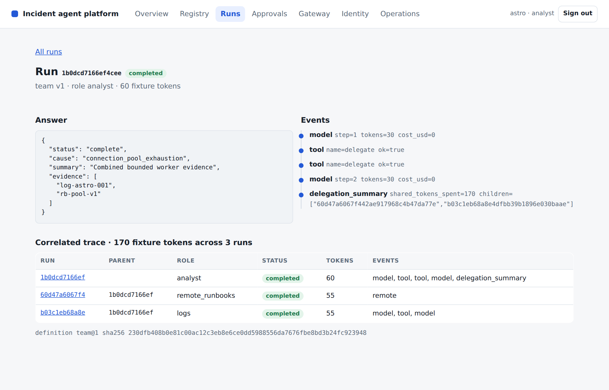

# Lesson 11 Operating and releasing agent platforms

*Instructor guide for the L3 agentic platform programme*

**Outcome** A runnable end-to-end platform combines the registry, the tool gateway, delegated credentials and a pinned A2A specialist with admission controls, correlated traces and evaluated, recorded rollout and rollback that operators can inspect in the console.

Duration: 120 minutes. Starting checkpoint: lesson-10. Ending checkpoint: lesson-11 (b0c78fa).

Word version: [11 Operating and releasing agent platforms.docx](11%20Operating%20and%20releasing%20agent%20platforms.docx)

## Where this session sits in the platform

This session adds the operations layer on top of the platform core, gateway and identity built in Sessions 08 to 10. Admission control and a worker semaphore bound the work the platform accepts; a correlated trace joins a parent run to its local and remote children; and every release decision is evaluated on the same cases and recorded with its evidence. The console gains the Operations view (capacity, runs by status and the release log) and a correlated trace on the run detail page.

| Session | Platform component | Status |
|---|---|---|
| 01 | Agent runtime: bounded ReAct loop, typed run state, event log | Built earlier |
| 02 | Tool contracts, approval boundary and MCP transport | Built earlier |
| 03 | Context selection, retrieval, memory and versioned artifacts | Built earlier |
| 04 | Evaluation harness and single-agent baseline | Built earlier |
| 05 | Durable runs, crash recovery and exact-action approval | Built earlier |
| 06 | Supervisor, scoped subagents and parallel coordination | Built earlier |
| 07 | Remote agents over A2A | Built earlier |
| 08 | Platform core: agent registry, run API and platform console | Built earlier |
| 09 | MCP tool gateway: policy, audit and shared upstream sessions | Built earlier |
| 10 | Agent identity, delegated credentials and credential store | Built earlier |
| 11 | Operations: traces, admission control and evaluated releases | **This session** |
| 12 | Tuning, before/after evidence and the capstone presentation | Later session |

## Preparation

Bring your Session 10 checkpoint with the registry, gateway and delegated credentials working, plus your evaluation harness and one saved failure trace. Review the idea of service-level objectives before class. The reference supplies everything used today: the trace view, the load and rollout demonstration and a restricted Docker and Compose recipe. There is no separate scaffolding package. Kubernetes appears only as an optional discussion of rollout and rollback; the reference contains no Kubernetes files.

Learners need two things: their own project repository in the course GitLab group, and the [learner kit](https://github.com/maxvpavlov/ciklum-innovate-l3-2026/tree/main/learner-kit) in the public course repository, which holds the starter project and, for each lesson, the given files and the check pack. Learners build their own implementation; the reference checkpoints in the same repository are the instructor's answer key.

Your coding agent handles preparation, implementation and execution. You set the scope, inspect its changes and explain the evidence. This development assistant is separate from the investigation agents inside the platform.

> **PROMPT** Prepare my learner project for Lesson 11. Open my project repository in my course GitLab group, cloning it into ~/agentic-course/my-platform if it is not there, and confirm it holds my completed lesson-10 work with all its checks passing. Update my read-only copy of the course repository in ~/agentic-course/course, cloning it from https://github.com/maxvpavlov/ciklum-innovate-l3-2026 if it is missing; its learner-kit folder is the course kit. Use the pinned Python 3.12 environment and the offline mock provider. Do not add this lesson's work yet. Report the project location, its current checkpoint, the test results and any missing prerequisites. Do not ask me to run terminal commands.

Next, have the coding agent read this lesson's check pack and add it to the project before any code is written.

> **PROMPT** Read learner-kit/lessons/11 in the course repository: its README, the given files and the check pack. Copy the whole given files and the check pack into my project exactly as the README says, without changing them, and commit that; a given definition that must be pasted into a module is added in the build step that creates or changes that module. Then run the tests and report what fails and why: at first this lesson's test file may fail to import, because the modules it needs do not exist yet. List the interfaces my code must provide, with the exact names, signatures, fields and error codes the tests use, and the capability they verify. Explain the implementation sequence before we begin. Do not write the implementation yet, and do not look for or use a finished solution.

**Instructor readiness** Rehearse the session with a learner project built from the course kit, so you see what learners see: the check pack fails until each capability is built. The reference checkpoint remains your answer key for the excerpts below. In class, use one bounded prompt at a time; learners inspect the change, explain the control decision and review the check evidence.

**Offline fallback** Have the coding agent use the offline mock provider for class. If live access fails, restore that configuration and continue. Keep credentials in secure configuration. Adapter request shapes were tested with mock HTTP; live account access was not exercised.

Pinned versions in pyproject.toml and uv.lock: Python 3.12, MCP 2.2.0, A2A SDK 1.1.2, httpx 0.28.1, FastAPI 0.141.1, uvicorn 0.52.4, jsonschema 4.26.0, pytest 9.1.1 and pytest-asyncio 1.4.0. Have the coding agent manage their installation.

## Timed agenda

| Minutes | Activity | Format |
|---|---|---|
| 00 to 10 | Reconnect to the incident and prior checkpoint | Discussion |
| 10 to 30 | Concept script and architecture questions | Discussion |
| 30 to 50 | Prompts and code review for steps 1 and 2 | Agent build |
| 50 to 75 | Prompts and code review for steps 3 and 4 | Agent build |
| 75 to 100 | Learner exercise and fault injection | Practice |
| 100 to 115 | Acceptance checks and result interpretation | Verification |
| 115 to 120 | Questions and checkpoint handoff | Discussion |

## Instructor script and code walkthrough

Use SAY for instructor narration, SHOW and REVIEW for the code and evidence participants examine, PROMPT for text they give their coding agents, and PAUSE for discussion. Prompts define scope and expected behaviour; the agent handles command execution. Code excerpts remain as reading and review material from the exact reference checkpoint, not manual typing instructions.

### Opening and orientation

**SAY** This is the final platform-building session. We will run one investigation through the whole platform: the registry selects the team definition and the pinned remote runbook specialist, the log worker reads through the tool gateway, and each child receives a narrower delegated credential. Then we inspect the parent and child runs as one trace, reject excess work under load, and evaluate a configuration change before activating it and rolling it back. Each release decision is recorded, so the console Operations view shows what was decided and why. By the end, participants should have the working platform promised at the start of the programme; Session 12 tunes and presents it. Begin by asking the group what evidence an operator needs when a parent run fails even though one child succeeded.

**SHOW** The coding agent’s baseline report, current learner project, synthetic incident records and lesson outcome. Ask participants to explain what already works before authorizing the next bounded change.

### Concept discussion

**SAY** Separate admission, execution concurrency and model budgets. A queue bound limits accepted outstanding work; a per-tenant rate limit controls how often one tenant may submit; a semaphore limits active workers. The shared team budget now reserves the parent's own allowance as well as each child's, so a supervisor cannot spend outside the limit it enforces on its workers. Trace records correlate run, parent, role, status, usage and events without exposing prompts or credentials; delegated tokens are never stored with a run, so they cannot appear in a trace. A release decision compares the same dataset and partition, checks quality against the baseline and applies explicit latency and usage limits, then records the decision whether or not the candidate is activated. Routing and caching are tuning options for Session 12. Do not infer a safe release from a faster average alone.

**PAUSE** Invite one learner to trace the control flow and another to identify a failure boundary. Resolve different interpretations before opening the implementation.

### 1 Bound admitted and active work

**SAY** Inspect the two rejection paths before sending load. queue_full means outstanding work has reached capacity; rate_limited means this tenant has submitted too often in the last second. Neither condition should let the server create unlimited waiting tasks. Platform.launch enters admission before claiming the run lease, and a rejected submission is saved with status rejected so operators can count it. The worker wrapper then acquires the semaphore and, in finally, leaves admission, releases the lease and forgets the task, including on cancellation. The API maps rate_limited to HTTP 429 and queue_full to 503. Run the cancellation test and verify that pending capacity returns to zero. Ask learners why a concurrency limit alone does not bound memory when any number of requests can wait behind it.

**SHOW** The current learner implementation and `incident/operations.py`. Use the following prompt to make the bounded change, then inspect the agent’s result.

> **PROMPT** For Lesson 11, continue in my learner project. Implement bounded admission and active-worker controls in incident/operations.py and connect them to Platform. Distinguish queue capacity from per-tenant arrival limits and active concurrency, record rejected submissions and map them to distinct API responses. Release admission, leases and tasks on success, failure and cancellation. Make the supervisor reserve its own allowance from the shared team budget. Show excess-work rejection and prove that cancellation restores capacity. Build to the interfaces the Lesson 11 check pack uses, and do not edit the check pack or the given files. Preserve earlier behaviour, run relevant checks and show the change and observed evidence. Stop at this step.

**REVIEW** Compare the coding agent’s change with this reference excerpt. It covers source lines 16 to 33 at lesson-11; common indentation is reduced for display. Ask the agent to explain material differences in behaviour.

```python
class Admission:
    def __init__(self, max_pending=8, per_second=5):
        self.max_pending, self.per_second = max_pending, per_second
        self.pending = 0
        self.arrivals = defaultdict(deque)

    def enter(self, tenant):
        if self.pending >= self.max_pending:
            raise CapacityError("queue_full")
        times, now = self.arrivals[tenant], time.monotonic()
        while times and times[0] <= now-1:
            times.popleft()
        if len(times) >= self.per_second:
            raise CapacityError("rate_limited")
        times.append(now); self.pending += 1

    def leave(self):
        self.pending -= 1
```

**Explain the choice** Admission protects the platform before expensive work begins; the semaphore controls how accepted work executes. They are complementary controls with different metrics and different client responses.

**ASK** Why distinguish HTTP 429 from queue overload?

**Likely answer** Rate limiting is an arrival policy for one tenant, so that client should slow down. A full queue is a service-capacity condition that affects everyone. Clients and operators need the actionable reason, and the console counts both.

**PAUSE** Have learners identify the boundary in their agent’s change and explain the expected failure behaviour. Compare it with the reference excerpt before accepting the change.

### 2 Correlate parent and child evidence

**SAY** Build the trace from the tenant-scoped parent and every run whose context names it as parent. The result lists run, parent, role, status, usage and events, redacted before it is returned. Run the hybrid team demo and verify three nodes: the analyst parent, the local logs worker that read through the gateway, and remote_runbooks, the child that represents the pinned A2A specialist. The run detail page in the console now shows the same correlated trace, and the HTML trace view escapes every value. Explain that this is an application trace view, not a configured OpenTelemetry collector. Ask learners what they can diagnose from an error code, a role and a lifecycle event when raw prompts and credentials are deliberately absent.

**SHOW** The current learner implementation and `incident/operations.py`. Use the following prompt to make the bounded change, then inspect the agent’s result.

> **PROMPT** For Lesson 11, continue in my learner project. Implement the tenant-scoped parent-and-child trace, its escaped HTML view and an API endpoint that returns it only to the owning tenant. Run the hybrid investigation through the registry-pinned remote specialist, the tool gateway and delegated credentials. Show the three correlated run nodes, their roles and events, and usage counted once per run. Explain that this is the application's trace view and identify any external observability integration that remains untested. Build to the interfaces the Lesson 11 check pack uses, and do not edit the check pack or the given files. Preserve earlier behaviour, run relevant checks and show the change and observed evidence. Stop at this step.

**REVIEW** Compare the coding agent’s change with this reference excerpt. It covers source lines 36 to 48 at lesson-11; common indentation is reduced for display. Ask the agent to explain material differences in behaviour.

```python
def build_trace(store, tenant, run_id):
    parent = store.load(tenant, run_id)
    children = []
    for row in store.db.execute("SELECT body FROM runs WHERE tenant=?", (tenant,)):
        body = json.loads(row[0])
        if body["context"].get("parent_id") == run_id:
            children.append(body)
    nodes = [parent.snapshot()] + children
    return redact({"root_id": run_id, "status": parent.status,
        "total_tokens": sum(n["tokens"] for n in nodes),
        "nodes": [{"id": n["context"]["run_id"], "parent_id": n["context"]["parent_id"],
                   "role": n["context"]["role"], "status": n["status"], "tokens": n["tokens"],
                   "events": n["events"]} for n in nodes]})
```

**Explain the choice** Correlation shows where work and failure occurred across service boundaries. The trace reads only the requesting tenant's rows and passes through redaction, and the HTML renderer escapes values rather than presenting executable content.

**ASK** Why count each run's usage separately before calculating a total?

**Likely answer** It makes ownership and double counting visible. The total adds the usage reported by each run exactly once: 60 for the parent and 55 for each child in the fixture.

**PAUSE** Have learners identify the boundary in their agent’s change and explain the expected failure behaviour. Compare it with the reference excerpt before accepting the change.



**CONSOLE** The run detail page for a team run. Point at the correlated trace: the analyst parent, the logs child and the remote_runbooks child, each with its own usage adding to 170 fixture tokens, and at the definition hash that pins the version the run used.

### 3 Evaluate and record a candidate before activation

**SAY** Read the gate as a set of reviewable conditions. The dataset hash and partition must match, quality must meet both the baseline and the minimum, and latency and usage must fit the chosen limits. Run a candidate single definition with a smaller context allowance through evaluate_platform, so the benchmark executes the immutable registry configuration that would be activated. Inspect individual rows when a check fails. Then record the decision in the release log with its checks and the baseline and candidate summaries; a rejected candidate is recorded too. Thresholds here are teaching values for the fixture workload, not universal service-level objectives. Ask participants to propose thresholds for their own task and name failures that would block a release regardless of the aggregate score.

**SHOW** The current learner implementation and `incident/operations.py`. Use the following prompt to make the bounded change, then inspect the agent’s result.

> **PROMPT** For Lesson 11, continue in my learner project. Implement release_gate and evaluate_platform using the actual immutable registry configurations, and add a release log that records every decision with its checks and summaries whether or not the candidate is activated. Compare the same dataset and partition, retain per-case rows and enforce explicit quality, latency and usage limits. Evaluate a candidate context policy and demonstrate that a degraded or mismatched report is rejected and recorded. Explain which thresholds are teaching values. Build to the interfaces the Lesson 11 check pack uses, and do not edit the check pack or the given files. Preserve earlier behaviour, run relevant checks and show the change and observed evidence. Stop at this step.

**REVIEW** Compare the coding agent’s change with this reference excerpt. It covers source lines 68 to 76 at lesson-11; common indentation is reduced for display. Ask the agent to explain material differences in behaviour.

```python
def release_gate(baseline, candidate, min_success=1.0, max_latency_ms=1000, max_tokens=200):
    checks = {
        "same_dataset": baseline["dataset_sha256"] == candidate["dataset_sha256"],
        "same_split": baseline["split"] == candidate["split"],
        "quality": candidate["success_rate"] >= max(min_success, baseline["success_rate"]),
        "latency": candidate["mean_latency_ms"] <= max_latency_ms,
        "tokens": candidate["mean_tokens"] <= max_tokens,
    }
    return {"approved": all(checks.values()), "checks": checks}
```

**Explain the choice** The evaluation executes versioned definitions through the platform and records their identity. A gate is meaningful only when it measures the candidate that will actually be activated, and a recorded decision can be reviewed later.

**ASK** Can a candidate pass by silently dropping the hardest cases?

**Likely answer** No. The dataset hash and partition must match, and reviewers should inspect case-level rows. The release log keeps the dataset hash with each decision.

**PAUSE** Have learners identify the boundary in their agent’s change and explain the expected failure behaviour. Compare it with the reference excerpt before accepting the change.

### 4 Exercise overload, rollout and rollback

**SAY** Run the end-to-end demo, then send six requests with capacity for two outstanding runs. Four are rejected while accepted work completes. Next evaluate version one and the candidate version two, inspect the gate, activate version two, record the release and roll back to version one. Activation changes the default for new runs; existing runs keep their original immutable configuration and hash. Open the console Operations view and find the recorded decision. Then open the Docker and Compose files and identify the non-root user, read-only filesystem, dropped capabilities and internal network. The Compose sandbox keeps state in tmpfs, so replacing the container discards it; the local SQLite path demonstrates persistent recovery. Kubernetes rollouts are a discussion topic only.

**SHOW** The current learner implementation and `incident/labs/l11.py`. Use the following prompt to make the bounded change, then inspect the agent’s result.

> **PROMPT** For Lesson 11, continue in my learner project. Complete the Session 11 end-to-end, overload, rollout and rollback demonstration. Show the correlated trace, accepted and rejected load, a passing candidate that is recorded and activated, and the return to the previous version. Show the release in the console Operations view. Inspect the existing restricted container recipe and run it only if the environment supports it. Report its temporary-state limitation and any untested deployment behaviour. Build to the interfaces the Lesson 11 check pack uses, and do not edit the check pack or the given files. Preserve earlier behaviour, run relevant checks and show the change and observed evidence. Stop at this step.

**REVIEW** Compare the coding agent’s change with this reference excerpt. It covers source lines 23 to 38 at lesson-11; common indentation is reduced for display. Ask the agent to explain material differences in behaviour.

```python
ids, rejected = [], 0
for _ in range(6):
    try: ids.append(platform.submit("astro", "analyst", "INC-001"))
    except CapacityError: rejected += 1
await asyncio.gather(*(platform.wait("astro", key) for key in ids))
assert rejected == 4
baseline = await evaluate_platform(platform, "single", 1)
spec = platform.registry.get("single", 1)["spec"]
platform.registry.register("single", 2, {**spec, "context_chars": 4500})
candidate = await evaluate_platform(platform, "single", 2)
gate = release_gate(baseline, candidate)
assert gate["approved"]
platform.registry.activate("single", 2)
platform.releases.record(baseline, candidate, gate, activated=True)
active = platform.registry.get("single")["version"]
platform.registry.activate("single", 1)
```

**Explain the choice** The demo connects technical controls to observable operational outcomes. Rollback changes which version is active rather than mutating the contents of an old version, and the release log keeps the evidence for the change.

**ASK** Why preserve the old definition after a successful rollout?

**Likely answer** Existing runs and release records still refer to it by version and hash, and rollback needs an identifiable prior configuration.

**PAUSE** Have learners identify the boundary in their agent’s change and explain the expected failure behaviour. Compare it with the reference excerpt before accepting the change.


**CONSOLE** The Operations view: admission and worker capacity, runs by status and the release log. Point at the recorded decision with every gate check and at "not activated": an approved candidate is still only activated by an explicit step. Latency figures vary between runs.

## Learner practice and checkpoints

> **PROMPT** Help me carry out the Lesson 11 learner exercise in my existing project: Run the hybrid end-to-end investigation and inspect its three-node trace in the API and the console. Lower queue capacity, send excess work and verify rejection and cleanup. Evaluate a deliberately worse candidate and show that the release gate blocks it and the release log records the rejection. Then activate a passing version and roll back. First state the expected outcomes, then run the experiment in a throwaway script outside tests/, or from a clean Git state you can restore. Show the observed results and explain any discrepancy. Keep the original acceptance criteria and restore temporary experiments when finished.

**VERIFY** Give the coding agent the verification prompt below, then inspect its evidence and explain the result in your own words.

> **PROMPT** Verify my Lesson 11 implementation against its completion criteria. Update the checkpoint indicator in incident/__init__.py to 11 only when the required capability is present. Run the full test suite, which includes the Lesson 11 check pack and every earlier lesson's tests, and then the Session 11 demonstration with python -m incident.lab 11, all unchanged and using the offline provider (MODEL_PROVIDER unset or set to mock). Confirm that the passing count matches the one in the Lesson 11 check pack README. Keep the expected outcomes unchanged. Report checks actually executed, failures, relevant output and any untested integration. Explain the result, then commit my work and push it to my GitLab repository. Do not equate an unrun or skipped check with a pass.

**Expected behaviour** The coding agent returns actual check results and the demonstration’s structured output. Run identifiers and elapsed times vary. Compare the status and capability outcomes with the recorded reference below, and investigate differences.

```json
{
  "end_to_end": {
    "status": "complete",
    "cause": "connection_pool_exhaustion",
    "summary": "Combined bounded worker evidence",
    "evidence": [
      "log-astro-001",
      "rb-pool-v1"
    ]
  },
  "trace_nodes": 3,
  "trace_roles": [
    "analyst",
    "logs",
    "remote_runbooks"
  ],
  "trace_file": "var/trace.html",
  "total_tokens": 170,
  "overload_rejected": 4,
  "release_gate": {
    "approved": true,
    "checks": {
      "same_dataset": true,
      "same_split": true,
      "quality": true,
      "latency": true,
      "tokens": true
    }
  },
  "activated_version": 2,
  "rollback_version": 1,
  "recorded_releases": 1
}
```

**PAUSE** Ask learners to explain the evidence before accepting the checkpoint. If a check fails, use the specific recovery prompt below and review the resulting correction.

## Completion criteria

- The end-to-end investigation cites both log and runbook evidence through the gateway and the pinned A2A specialist.
- The trace includes the parent and two child nodes, and another tenant receives 404 for it.
- Excess work is rejected with a distinct reason, and cancellation releases capacity.
- A tiny shared parent-and-child budget prevents execution.
- A degraded or mismatched evaluation blocks release, every decision appears in the release log and the Operations view, and activation can return to the previous version.

The independently unpacked lesson-11 checkpoint passed its full test suite and this lesson demo, and so does the Lesson 11 check pack from the course kit. Recorded test result: 48 passed in 18.72s. Learners commit and push their checkpoint to their GitLab repository; lesson-11 (b0c78fa) remains the instructor's answer key.

### Files changed in this checkpoint

In the reference, this checkpoint changed the files below. Learners write the implementation files themselves; the lab, the tests and any given files arrive in the Lesson 11 check pack. Ask the agent to explain any additional file changes it needs.

- `.dockerignore`
- `Dockerfile`
- `compose.yaml`
- `incident/__init__.py`
- `incident/api.py`
- `incident/client.py`
- `incident/console/views/index.js`
- `incident/console/views/operations.js`
- `incident/console/views/runs.js`
- `incident/labs/l11.py`
- `incident/operations.py`
- `incident/platform.py`
- `incident/supervisor.py`
- `tests/test_lesson11.py`

> **PROMPT** Review my completed Lesson 11 work against the Lesson 11 check pack and completion criteria. Show the files I changed and the interfaces I provide, and explain how each completion criterion is met with code or test evidence. Point out the design choices I made that the check pack does not force, and what each one costs or gains. Preserve deliberate improvements and earlier capabilities.

## Demo troubleshooting

### The parent completes but a trace child is missing

> **PROMPT** I am working on Lesson 11. The symptom is: The parent completes but a trace child is missing. Diagnostic focus: Child persistence or parent correlation may have been omitted, or the remote child was saved under another tenant. Recovery guidance: Inspect the child run IDs in the delegation summary, confirm each child context carries the parent ID and tenant, and save completed child snapshots before building the trace. Reproduce the issue, make the smallest necessary correction and rerun affected checks. Report the cause, changed files and observed outcome. Preserve security controls and acceptance criteria.

### Capacity remains full after cancellation

> **PROMPT** I am working on Lesson 11. The symptom is: Capacity remains full after cancellation. Diagnostic focus: The worker cleanup may not leave admission, release its lease or remove the task. Recovery guidance: Run the cancellation regression test and keep all three cleanup actions in the worker's finally block for both waiting and active work. Reproduce the issue, make the smallest necessary correction and rerun affected checks. Report the cause, changed files and observed outcome. Preserve security controls and acceptance criteria.

### The Operations view shows no release decisions

> **PROMPT** I am working on Lesson 11. The symptom is: The Operations view shows no release decisions. Diagnostic focus: The gate may have been evaluated without recording the decision, or the release log may use a different database from the API process. Recovery guidance: Record every decision, including rejections, in the platform's release log, confirm the API and the demo share the platform database, and check the operations endpoint before the console. Reproduce the issue, make the smallest necessary correction and rerun affected checks. Report the cause, changed files and observed outcome. Preserve security controls and acceptance criteria.

### Container replacement loses sandbox state

> **PROMPT** I am working on Lesson 11. The symptom is: Container replacement loses sandbox state. Diagnostic focus: The supplied restricted Compose recipe uses tmpfs for the writable state directory. Recovery guidance: Use the local persistent SQLite demo for recovery exercises, or provision and test a persistent deployment volume before relying on container restart durability. Reproduce the issue, make the smallest necessary correction and rerun affected checks. Report the cause, changed files and observed outcome. Preserve security controls and acceptance criteria.

## Practice and discussion

- Choose a small set of capstone tuning changes and preserve a before report on the same cases.
- Compare cold and warm cache behaviour separately, and identify how tenant, configuration version and freshness affect validity.
- Prepare the console route and the failure trace you will explain during the capstone, and discuss what an optional Kubernetes rollout would add to or duplicate from the registry's activation and rollback.

**Discussion prompt** Which decision would change for a larger or more sensitive workload, and what additional evidence would you require before changing it? Tie the answer to the code, the task requirements and the acceptance checks.

## Verification scope

All course tags were independently unpacked and tested. The completed repository has 51 passing tests. Real local MCP stdio, the tool gateway's shared sessions and pinned definitions, A2A HTTP discovery, streaming, delegated-token authentication and cancellation were exercised. The platform console was driven in a headless Chromium browser against every checkpoint from lesson-08 onward.

Live model credentials, paid provider calls, live model judging, third-party MCP or A2A services, remote MCP OAuth, an enterprise identity provider, a managed secret vault, production cloud rollout and an external observability collector were not tested. The offline provider is a deterministic fixture, so its usage and quality results are teaching measurements. Read TESTING.md for the full scope and environment details.

The SQLite mock-effect ledger proves its local transaction boundary. It does not guarantee exactly-once effects for arbitrary external APIs. The A2A specialist task store is in memory. The restricted Compose sandbox uses temporary writable state; persistent deployment storage requires separate configuration and validation.

Tokens are HMAC-signed with one shared development key so the course runs offline; a production issuer signs asymmetrically and publishes verification keys. The credential store keeps values in process memory and is not a vault. The gateway runs in the platform process; production gateways are usually separate network services.

## Session close

**SAY** The guided build is complete. You have a runnable sandbox platform with a registry, a tool gateway, delegated identity, a console and operational controls around the agent runtime. Preserve this checkpoint and its baseline evaluation. Session 12 focuses on measured tuning and on presenting what you built through the console.

## References and further study

- [Distributed traces](https://opentelemetry.io/docs/concepts/signals/traces/)
- [Evaluation and regression checks](https://www.anthropic.com/engineering/demystifying-evals-for-ai-agents)
- [Rollout and rollback example (optional Kubernetes discussion)](https://kubernetes.io/docs/concepts/workloads/controllers/deployment/)
