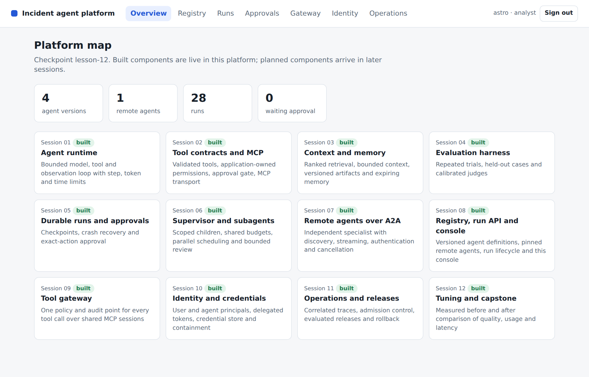
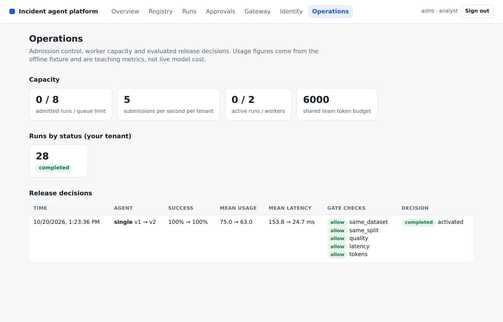
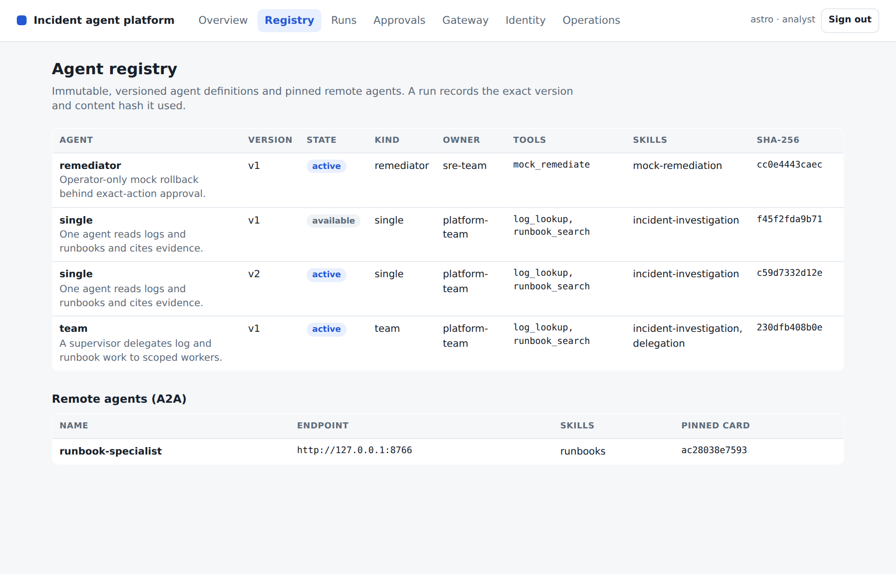

# Lesson 12 Tune and present your agentic platform

*Instructor guide for the L3 agentic platform programme*

**Outcome** Participants present the platform they built through its own console, justify a bounded tuning change with comparable, recorded evidence and explain the architecture, the four platform components, failures and remaining limitations.

Duration: 90 minutes. Starting checkpoint: lesson-11. Ending checkpoint: lesson-12 (40bd536).

Word version: [12 Tune and present your agentic platform.docx](12%20Tune%20and%20present%20your%20agentic%20platform.docx)

## Where this session sits in the platform

This session completes the platform rather than adding a component. A tuning change becomes a new immutable registry version, is evaluated against the baseline on the same cases, and is activated only through a recorded release decision. The console is the presentation surface: the Overview map shows all twelve components built, the Registry shows single v2 active, and the Runs, Gateway, Identity and Operations views supply the evidence for the capstone.

| Session | Platform component | Status |
|---|---|---|
| 01 | Agent runtime: bounded ReAct loop, typed run state, event log | Built earlier |
| 02 | Tool contracts, approval boundary and MCP transport | Built earlier |
| 03 | Context selection, retrieval, memory and versioned artifacts | Built earlier |
| 04 | Evaluation harness and single-agent baseline | Built earlier |
| 05 | Durable runs, crash recovery and exact-action approval | Built earlier |
| 06 | Supervisor, scoped subagents and parallel coordination | Built earlier |
| 07 | Remote agents over A2A | Built earlier |
| 08 | Platform core: agent registry, run API and platform console | Built earlier |
| 09 | MCP tool gateway: policy, audit and shared upstream sessions | Built earlier |
| 10 | Agent identity, delegated credentials and credential store | Built earlier |
| 11 | Operations: traces, admission control and evaluated releases | Built earlier |
| 12 | Tuning, before/after evidence and the capstone presentation | **This session** |

## Preparation

Bring the working Session 11 platform and its checks. Choose a small set of tuning changes, measure before and after results on the same evaluation cases, and prepare a short architecture and demo narrative with code, traces and benchmarks. Before class, apply the tuned version and its recorded release to the platform database the console reads, and rehearse the console route you will present: Overview, Registry, a team run with its trace, Gateway, Identity and Operations.

Give your coding agent access to the supplied incident-platform.zip or the reference repository in the [course materials folder](https://drive.google.com/drive/u/0/folders/1wos8PjyC0mTDQxrcZ89b9mG0yYV57Zr3). Ask it to preserve the embedded checkpoint history and identify the learner project separately from the reference.

Your coding agent handles preparation, implementation and execution. You set the scope, inspect its changes and explain the evidence. This development assistant is separate from the investigation agents inside the platform.

> **PROMPT** Prepare my Python learner project for Lesson 12, starting from lesson-11. Locate the supplied reference repository and my existing work; ask for their locations if needed. Preserve my changes and handle repository setup, dependency installation and environment configuration yourself. Use the pinned Python 3.12 environment and offline mock provider. Establish the starting checkpoint without adding this lesson yet. Run the baseline checks and report the workspace, checkpoint, results and any missing prerequisites. Do not ask me to run terminal commands.

Next, orient the coding agent to the reference while preserving your work.

> **PROMPT** Compare my current project with lesson-11 and prepare a read-only view of lesson-12 for this lesson. Preserve my work while arranging any isolation needed. Identify differences, relevant files and the expected capability. Explain the implementation sequence before we begin; do not replace my project with the finished reference or add later lessons.

**Instructor readiness** Have your coding agent rehearse the completed reference and prepare the current tests, fixtures and lab runner before class. Tests may fail until the capability is implemented. During class, use one bounded prompt at a time; learners inspect the change, explain the control decision and review the check evidence.

Require the working Session 11 platform and before and after evidence in advance, including a console that starts on the participant's own platform database. Use review groups or recorded demonstrations for a large cohort so every participant receives review within the 90-minute session. Keep the completed reference and its screenshots ready as a fallback if a live console fails.

**Offline fallback** Have the coding agent use the offline mock provider for class. If live access fails, restore that configuration and continue. Keep credentials in secure configuration. Adapter request shapes were tested with mock HTTP; live account access was not exercised.

Pinned versions in pyproject.toml and uv.lock: Python 3.12, MCP 2.2.0, A2A SDK 1.1.2, httpx 0.28.1, FastAPI 0.141.1, uvicorn 0.52.4, jsonschema 4.26.0, pytest 9.1.1 and pytest-asyncio 1.4.0. Have the coding agent manage their installation.

## Timed agenda

| Minutes | Activity | Format |
|---|---|---|
| 00 to 10 | Readiness check and presentation criteria | Discussion |
| 10 to 30 | Guided tuning walkthrough: steps 1 to 3 on the reference | Demo |
| 30 to 35 | Step 4: the console presentation route | Demo |
| 35 to 70 | Participant or review-group demonstrations through the console | Presentation |
| 70 to 82 | Evidence review and architecture questions | Review |
| 82 to 90 | Adoption decisions and follow-up actions | Discussion |

## Instructor script and code walkthrough

Use SAY for instructor narration, SHOW and REVIEW for the code and evidence participants examine, PROMPT for text they give their coding agents, and PAUSE for discussion. Prompts define scope and expected behaviour; the agent handles command execution. Code excerpts remain as reading and review material from the exact reference checkpoint, not manual typing instructions.

### Opening and orientation

**SAY** Today we review the platform you have already built. Start from a working Session 11 checkpoint and a small, explicit tuning hypothesis. The build steps are a short guided walkthrough on the reference, not new construction: participants should have run them before class. The strongest presentation is delivered through the platform console. It shows the platform map, the versioned definition that was released, one end-to-end run with its trace, the gateway's audit and the delegation chain, and the recorded release decision. It compares before and after on the same cases and demonstrates one control or recovery behaviour. The reference's simulated usage improvement demonstrates measurement mechanics; it is not evidence that a real model became cheaper or more capable.

**SHOW** The coding agent’s baseline report, current learner project, synthetic incident records and lesson outcome. Ask participants to explain what already works before authorizing the next bounded change.

### Concept discussion

**SAY** Frame every tuning change as a hypothesis, intervention, comparison and decision. Keep the dataset, partition and measurement conditions stable. The reference registers single version two with an efficient provider profile: the fixture finishes early when structured log evidence is sufficient and keeps the longer path for ambiguous or missing evidence. Across the five cases it reduces mean simulated usage from 75 to 63 while preserving the fixture's success rate. That is a 16 percent reduction in this controlled fixture. The release gate approves it, the platform activates it and the release log records the decision. The separate cache example distinguishes cold from warm runs and scopes entries by tenant and configuration. Routing selects a careful provider when observations are incomplete or failed. Live-model quality, cost and latency need real credentials and configured pricing before any deployment claim.

**PAUSE** Invite one learner to trace the control flow and another to identify a failure boundary. Resolve different interpretations before opening the implementation.



**CONSOLE** The Overview map at lesson-12: every component from Session 01 to Session 12 is marked built. Use it as the first slide of a capstone presentation and point at the counts of agent versions and remote agents.

### 1 State the hypothesis and inspect the change

**SAY** Explain the hypothesis in one sentence: when the diagnostic log already provides sufficient structured evidence, the fixture can stop without a redundant runbook request. Read the early-finish condition and identify the cases where it must not apply. Missing and unknown evidence keep the original behaviour. The platform selects this provider only when a definition's provider_profile is efficient, so the change lives in a new registry version rather than in version one. Emphasise that this is an intentionally transparent fixture policy, not a general recommendation to skip retrieval. Ask each participant to state their own intervention just as narrowly. A collection of unrelated changes makes it difficult to attribute an improvement or diagnose a regression.

**SHOW** The current learner implementation and `incident/tuning.py`. Use the following prompt to make the bounded change, then inspect the agent’s result.

> **PROMPT** For Lesson 12, continue in my learner project. Review my working Session 11 platform and the capstone reference. Help me state one bounded tuning hypothesis and identify the smallest change needed to test it, expressed as a new immutable registry version. Explain the EfficientMockProvider example, how the platform selects it from the definition's provider profile, and where early completion is safe or unsafe in these fixtures. Preserve the baseline and define the evidence that would justify adopting or rejecting my change before implementing it. Use lesson-12 read-only to check compatibility. Preserve earlier behaviour, run relevant checks and show the change and observed evidence. Stop at this step.

**REVIEW** Compare the coding agent’s change with this reference excerpt. It covers source lines 10 to 20 at lesson-12; common indentation is reduced for display. Ask the agent to explain material differences in behaviour.

```python
class EfficientMockProvider(MockProvider):
    """Fixture-only policy experiment: sufficient structured log evidence can finish early."""
    async def complete(self, messages, tools, max_tokens=500):
        observations = [json.loads(m["content"]) for m in messages if m["role"] == "tool"]
        if observations:
            item = observations[0].get("data")
            if isinstance(item, dict) and item.get("cause") not in {None, "unknown"}:
                return Reply({"role": "assistant", "content": json.dumps({"status": "complete",
                    "cause": item["cause"], "summary": "Sufficient diagnostic log evidence",
                    "evidence": [item["source_id"]]})}, 35)
        return await super().complete(messages, tools, max_tokens)
```

**Explain the choice** A small change supports an interpretable comparison. The policy is applied through a new immutable registry version rather than by mutating the baseline, so both versions remain comparable and reversible.

**ASK** Why does the mean become 63 rather than 55?

**Likely answer** Three of five fixture cases finish with 55 simulated usage units, while two retain 75. The mean is (3 times 55 plus 2 times 75) divided by 5, which is 63.

**PAUSE** Have learners identify the boundary in their agent’s change and explain the expected failure behaviour. Compare it with the reference snapshot before accepting the change.

### 2 Run a comparable evaluation and record the release

**SAY** Run three trials for each case under version one, then register the efficient version two and evaluate it with the same platform, dataset and trial count. Inspect the release gate and the individual rows before quoting the summary. The result should preserve fixture success and show the reduced simulated usage. Only then activate version two and record the release, so the Operations view shows the decision with its checks and summaries. Do not reuse these numbers as live-model economics. For a live experiment, report the actual provider, model, configuration, pricing, sampling conditions and test set. Ask participants to show one case that could have regressed and explain how the evaluation would reveal it.

**SHOW** The current learner implementation and `incident/labs/l12.py`. Use the following prompt to make the bounded change, then inspect the agent’s result.

> **PROMPT** For Lesson 12, continue in my learner project. Apply the selected tuning change as a new registry version. Evaluate before and after on the same cases, partitions and trial conditions, retaining failures and per-case rows. Use the actual platform path. Activate the candidate only if the release gate approves it, and record the decision in the release log either way. Keep fixture usage separate from live-model economics and preserve the original expected outcomes. Show the comparison, the recorded decision and its limitations. Use lesson-12 read-only to check compatibility. Preserve earlier behaviour, run relevant checks and show the change and observed evidence. Stop at this step.

**REVIEW** Compare the coding agent’s change with this reference excerpt. It covers source lines 15 to 24 at lesson-12; common indentation is reduced for display. Ask the agent to explain material differences in behaviour.

```python
platform = Platform(str(Path(directory)/"platform.db"), admission=Admission(per_second=1000))
try:
    baseline = await evaluate_platform(platform, "single", 1, trials=3)
    original = platform.registry.get("single", 1)["spec"]
    platform.registry.register("single", 2, {**original, "provider_profile": "efficient"})
    candidate = await evaluate_platform(platform, "single", 2, trials=3)
    gate = release_gate(baseline, candidate)
    assert gate["approved"] and candidate["mean_tokens"] < baseline["mean_tokens"]
    platform.registry.activate("single", 2)
    platform.releases.record(baseline, candidate, gate, activated=True)
```

**Explain the choice** The experiment uses the actual versioned platform path. Equivalent evaluation conditions make the difference interpretable, and the recorded release ties the activation to its evidence.

**ASK** What would make the comparison invalid even if the new mean is better?

**Likely answer** Changing the dataset, hiding failed cases, mixing cold and warm cache conditions, changing pricing assumptions or evaluating a different configuration from the one activated and presented.

**PAUSE** Have learners identify the boundary in their agent’s change and explain the expected failure behaviour. Compare it with the reference snapshot before accepting the change.



**CONSOLE** The Operations view after the capstone release: single v1 to v2 with success unchanged at 100%, mean fixture usage 75.0 to 63.0, every gate check allowed and the decision activated. Latency values vary between runs and are not a performance claim.

### 3 Explain caching and routing tradeoffs

**SAY** Walk through the cache key before discussing hits. Tenant, configuration hash, messages, tool schemas and output allowance all affect whether a cached response is applicable. Expiry controls freshness, and the example bypasses the cache whenever the effectful mock tool is available. Show the cold and warm measurements separately. Then inspect RoutingProvider in the same file: incomplete or failed observations select the careful path. A real routing policy needs evaluation because a cheaper model can make an expensive mistake. Neither experiment is activated in the registry; both are separate capstone options. Ask learners to explain one situation where an apparently helpful cache would return stale or unauthorised information.

**SHOW** The current learner implementation and `incident/tuning.py`. Use the following prompt to make the bounded change, then inspect the agent’s result.

> **PROMPT** For Lesson 12, continue in my learner project. Help me evaluate caching or routing as a separate capstone experiment when relevant. Preserve tenant, configuration, input, schema and freshness boundaries in cache identity, and report cold and warm behaviour separately. Check uncertainty routing without assuming a cheaper provider is always adequate. Run the focused tests and explain the correctness risks and the evidence needed for a live deployment. Use lesson-12 read-only to check compatibility. Preserve earlier behaviour, run relevant checks and show the change and observed evidence. Stop at this step.

**REVIEW** Compare the coding agent’s change with this reference excerpt. It covers source lines 23 to 39 at lesson-12; common indentation is reduced for display. Ask the agent to explain material differences in behaviour.

```python
class CachedProvider:
    def __init__(self, inner, tenant, config_hash, cache=None, ttl=60):
        self.inner, self.tenant, self.config_hash = inner, tenant, config_hash
        self.cache, self.ttl, self.hits = cache if cache is not None else {}, ttl, 0

    async def complete(self, messages, tools, max_tokens=500):
        if any(t["function"]["name"] == "mock_remediate" for t in tools):
            return await self.inner.complete(messages, tools, max_tokens)
        key = hashlib.sha256(json.dumps([self.tenant, self.config_hash, messages, tools, max_tokens],
                                         sort_keys=True).encode()).hexdigest()
        cached = self.cache.get(key)
        if cached and cached[0] > time.monotonic():
            self.hits += 1
            return Reply(copy.deepcopy(cached[1].message), tokens=0, cost_usd=0)
        result = await self.inner.complete(messages, tools, max_tokens)
        self.cache[key] = (time.monotonic()+self.ttl, copy.deepcopy(result))
        return result
```

**Explain the choice** Caching and routing are tuning mechanisms with correctness conditions. The reference tests cross-tenant separation, configuration changes, expiry and uncertainty routing independently of live-model behaviour.

**ASK** Why not report the warm-cache result as the normal model cost?

**Likely answer** It represents a different operating condition. Report the hit rate and separate cold and warm behaviour on a representative workload.

**PAUSE** Have learners identify the boundary in their agent’s change and explain the expected failure behaviour. Compare it with the reference snapshot before accepting the change.

### 4 Present the platform through the console

**SAY** Use the saved comparison report as supporting evidence, then present the platform itself through the console. Start at the Overview map with all twelve components built. Open the Registry and show single version two active beside version one, each with its hash. Submit a team run and walk its correlated trace, then show the Gateway audit for its tool calls and the Identity view with the delegation chain. Finish in Operations with the recorded release. Demonstrate one permission rejection, cancellation or recovery case, and close with a decision: adopt, keep experimental or reject. Ask the reviewer to challenge one architectural assumption; the participant should answer from code, traces and records rather than a fluent narrative.

**SHOW** The current learner implementation and `incident/labs/l12.py`. Use the following prompt to make the bounded change, then inspect the agent’s result.

> **PROMPT** For Lesson 12, continue in my learner project. Prepare a console demonstration of my completed platform and a concise evidence pack: the platform map, the registry with the released version, one end-to-end run with its trace, gateway audit and delegation chain, one permission or recovery failure case, and the recorded before-and-after release. Use actual code and recorded results, clearly identifying anything not demonstrated live. Ask me to explain the tradeoffs in my own words. Do not invent improvements or adopt a change whose evidence is inadequate. Use lesson-12 read-only to check compatibility. Preserve earlier behaviour, run relevant checks and show the change and observed evidence. Stop at this step.

**REVIEW** Compare the coding agent’s change with this reference excerpt. It covers source lines 29 to 40 at lesson-12; common indentation is reduced for display. Ask the agent to explain material differences in behaviour.

```python
report = {"interpretation": "Synthetic fixture policy experiment; not a live model benchmark.",
    "baseline": baseline, "candidate": candidate, "release_gate": gate,
    "token_reduction_percent": round(100*(1-candidate["mean_tokens"]/baseline["mean_tokens"]),2),
    "cache_experiment": {"cold_tokens": cold.tokens, "warm_tokens": warm.tokens, "hits": cached.hits}}
path = Path("var/capstone-comparison.json"); path.parent.mkdir(exist_ok=True)
path.write_text(json.dumps(report, indent=2))
return {"baseline_success": baseline["success_rate"], "candidate_success": candidate["success_rate"],
        "baseline_mean_tokens": baseline["mean_tokens"], "candidate_mean_tokens": candidate["mean_tokens"],
        "token_reduction_percent": report["token_reduction_percent"],
        "cache_experiment": report["cache_experiment"], "report_file": str(path),
        "interpretation": report["interpretation"],
        "release_log": {k: platform.releases.list()[0][k] for k in ["agent", "baseline_version", "candidate_version", "approved", "activated"]}}
```

**Explain the choice** The capstone assesses ownership of the implementation and quality of judgement. A working console demonstration backed by recorded evidence is stronger than a feature list or a generated slide.

**ASK** What should a participant do if the tuning result is negative?

**Likely answer** Present it honestly, show the rejected decision in the release log, explain what was learned and keep the better baseline active. A justified rejection demonstrates sound engineering judgement.

**PAUSE** Have learners identify the boundary in their agent’s change and explain the expected failure behaviour. Compare it with the reference snapshot before accepting the change.



**CONSOLE** The Registry during the presentation: single v2 is active and v1 remains available with its own hash, which is what makes rollback possible. Point also at the pinned Agent Card hash of the remote runbook specialist.

## Learner practice and checkpoints

> **PROMPT** Help me carry out the Lesson 12 learner exercise in my existing project: Before class, select a small tuning intervention, apply it as a new registry version and generate a comparable before-and-after report with a recorded release decision. During class, present the working platform through its console and demonstrate one failure-control case. Explain the evidence, tradeoffs and adoption decision. Use the fixture experiment only as a rehearsal when live model access is unavailable. First state the expected outcomes, then run the experiment in a recoverable state. Show the observed results and explain any discrepancy. Keep the original acceptance criteria and restore temporary experiments when finished.

**VERIFY** Give the coding agent the verification prompt below, then inspect its evidence and explain the result in your own words.

> **PROMPT** Verify my Lesson 12 implementation against its completion criteria. Update the checkpoint indicator in incident/__init__.py to 12 only when the required capability is present. Run tests/test_lesson12.py, the Session 12 demonstration and the existing regression suite using the offline provider. Keep the expected outcomes unchanged. Report checks actually executed, failures, relevant output and any untested integration. Explain the result and save a recoverable checkpoint of my work. Do not equate an unrun or skipped check with a pass.

**Expected behaviour** The coding agent returns actual check results and the demonstration’s structured output. Run identifiers and elapsed times vary. Compare the status and capability outcomes with the recorded reference below, and investigate differences.

```json
{
  "baseline_success": 1.0,
  "candidate_success": 1.0,
  "baseline_mean_tokens": 75,
  "candidate_mean_tokens": 63,
  "token_reduction_percent": 16.0,
  "cache_experiment": {
    "cold_tokens": 75,
    "warm_tokens": 0,
    "hits": 3
  },
  "report_file": "var/capstone-comparison.json",
  "interpretation": "Synthetic fixture policy experiment; not a live model benchmark.",
  "release_log": {
    "agent": "single",
    "baseline_version": 1,
    "candidate_version": 2,
    "approved": true,
    "activated": true
  }
}
```

**PAUSE** Ask learners to explain the evidence before accepting the checkpoint. If a check fails, use the specific recovery prompt below and review the resulting correction.

## Completion criteria

- The Session 11 platform still runs end to end.
- The intervention is explicit and tied to a new registry version or a documented patch.
- Before and after use comparable cases and conditions, with failures visible, and the decision is recorded in the release log.
- The presentation shows evidence for each platform component: the registry version and hash, gateway audit entries, a delegation chain and the console views that display them.
- Permission, recovery or cancellation behaviour is demonstrated.
- The presenter can explain code ownership, protocol boundaries, measurements and limitations.

The independently unpacked lesson-12 checkpoint passed its full test suite and this lesson demo. Recorded test result: 51 passed in 20.67s. Have your coding agent save a recoverable learner checkpoint and retain the comparison with lesson-12 (40bd536).

### Files changed in this checkpoint

Use this inventory to scope the coding agent’s work. It includes core files, lab scaffolding, acceptance tests and checkpoint metadata. Ask the agent to explain any additional file changes it needs.

- `incident/__init__.py`
- `incident/labs/l12.py`
- `incident/platform.py`
- `incident/tuning.py`
- `tests/test_lesson12.py`

> **PROMPT** Compare my completed Lesson 12 work with reference lesson-12. Show the changed files, interfaces and important behavioural differences. Explain how each completion criterion is met with code or test evidence. Preserve deliberate learner improvements and earlier capabilities; do not overwrite my work merely to obtain a textually identical copy.

## Demo troubleshooting

### The demo fails during a presentation

> **PROMPT** I am working on Lesson 12. The symptom is: The demo fails during a presentation. Diagnostic focus: Locate the failing checkpoint, service, console view or configuration and preserve the error evidence. Recovery guidance: Use the prepared completed reference snapshot, its console screenshots and the saved trace to continue the explanation. State which part was demonstrated live and which was shown from recorded evidence. Reproduce the issue, make the smallest necessary correction and rerun affected checks. Report the cause, changed files and observed outcome. Preserve security controls and acceptance criteria.

### The console does not show the tuned version or its release

> **PROMPT** I am working on Lesson 12. The symptom is: The console does not show the tuned version or its release. Diagnostic focus: The candidate may have been evaluated in a temporary database, as the lab does, rather than in the platform database the API reads, or it was recorded but not activated. Recovery guidance: Register, evaluate, activate and record the candidate against the platform database the console uses, then confirm the registry and operations endpoints before presenting. Reproduce the issue, make the smallest necessary correction and rerun affected checks. Report the cause, changed files and observed outcome. Preserve security controls and acceptance criteria.

### A participant presents fixture usage as real savings

> **PROMPT** Review my Lesson 12 presentation claims against the recorded comparison report and release log. Identify any synthetic fixture usage described as real model cost or savings. Correct those claims and label the measurement conditions clearly. Explain what live benchmark and pricing evidence would be needed to estimate actual cost. Preserve the recorded results and do not invent an improvement.

### There is not enough time for every individual presentation

> **PROMPT** Help me organize Lesson 12 presentations within the existing 90-minute agenda. Ask for the cohort size if it is missing. Allocate the 35-to-70-minute presentation block using review groups or pre-recorded console demonstrations when necessary. Keep the remaining agenda timings and shared review criteria, give every participant a review opportunity and prepare a short plenary discussion. Show the proposed schedule and timing totals; no implementation changes are needed.

## Practice and discussion

- Submit the tuned repository, runbook, console demo narrative, comparison report, release record and remaining limitations.
- Include evidence for the four platform components: registry versions and pins, gateway audit, identity and delegation chains, and the console views that show them.
- Address review findings and keep the baseline version available so the tuning decision can be revisited.

**Discussion prompt** Which decision would change for a larger or more sensitive workload, and what additional evidence would you require before changing it? Tie the answer to the code, the task requirements and the acceptance checks.

## Verification scope

All course tags were independently unpacked and tested. The completed repository has 51 passing tests. Real local MCP stdio, the tool gateway's shared sessions and pinned definitions, A2A HTTP discovery, streaming, delegated-token authentication and cancellation were exercised. The platform console was driven in a headless Chromium browser against every checkpoint from lesson-08 onward.

Live model credentials, paid provider calls, live model judging, third-party MCP or A2A services, remote MCP OAuth, an enterprise identity provider, a managed secret vault, production cloud rollout and an external observability collector were not tested. The offline provider is a deterministic fixture, so its usage and quality results are teaching measurements. Read TESTING.md for the full scope and environment details.

The SQLite mock-effect ledger proves its local transaction boundary. It does not guarantee exactly-once effects for arbitrary external APIs. The A2A specialist task store is in memory. The restricted Compose sandbox uses temporary writable state; persistent deployment storage requires separate configuration and validation.

Tokens are HMAC-signed with one shared development key so the course runs offline; a production issuer signs asymmetrically and publishes verification keys. The credential store keeps values in process memory and is not a vault. The gateway runs in the platform process; production gateways are usually separate network services.

## Session close

**SAY** The course outcome is a platform you can run, inspect and explain through its own console. Your capstone decision should follow from recorded evidence, including evidence that an attractive change should not be adopted. Keep the tests, checkpoints, release log and runbook as the basis for future development.

## References and further study

- [Evaluation evidence and grading](https://www.anthropic.com/engineering/demystifying-evals-for-ai-agents)
- [Multi-agent design tradeoffs](https://www.anthropic.com/engineering/multi-agent-research-system)
- [A2A Agent Discovery](https://a2a-protocol.org/latest/topics/agent-discovery/)
